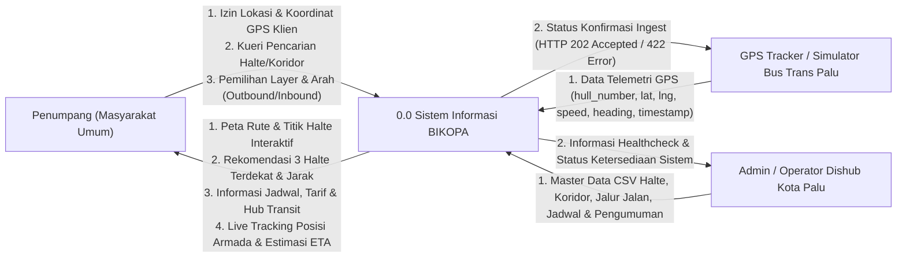
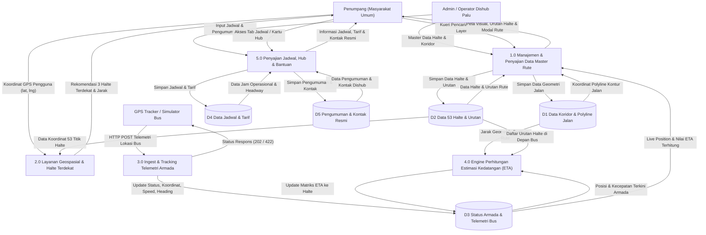
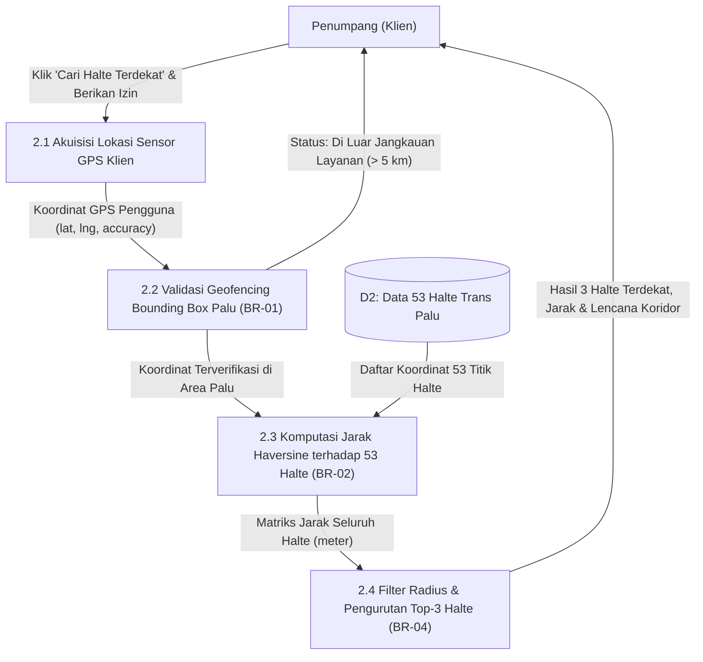
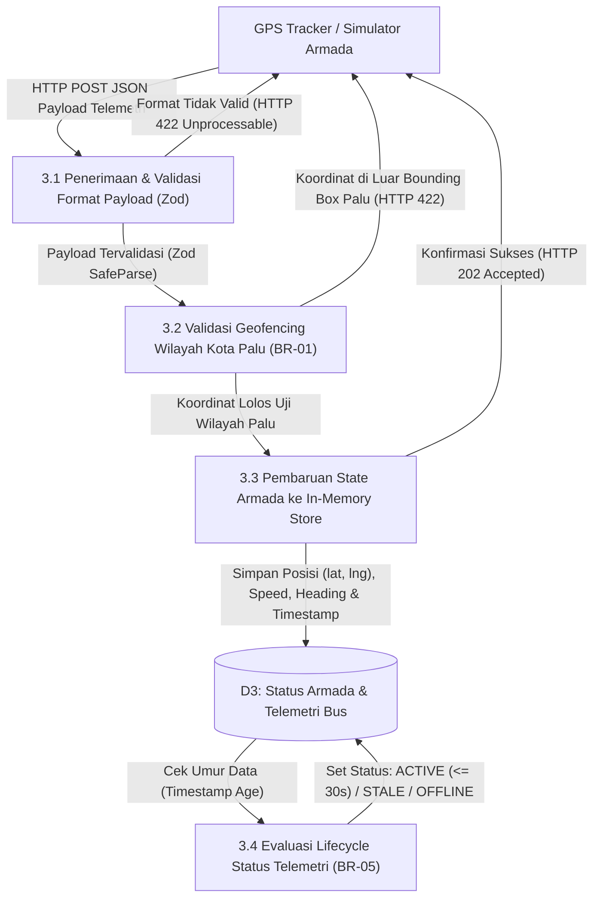
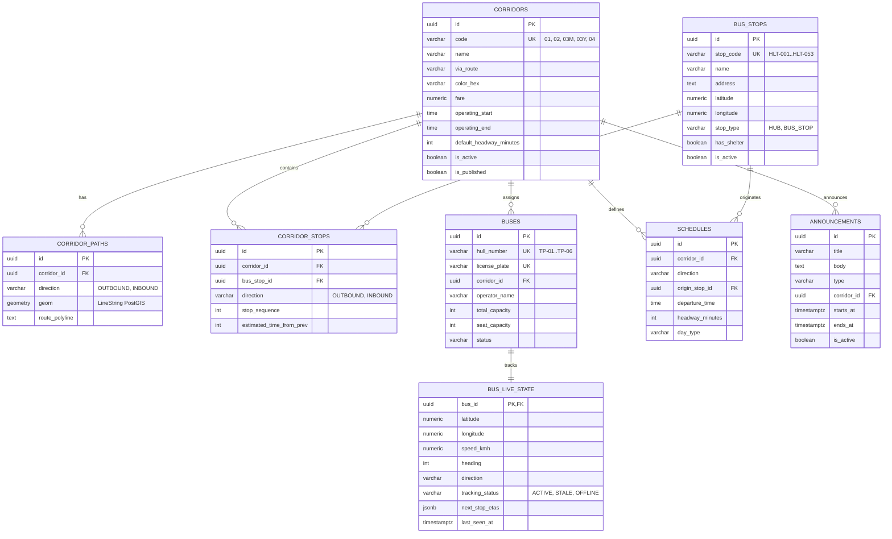

# DOKUMEN KEBUTUHAN PRODUK (PRD) & SPESIFIKASI TEKNIS SISTEM
# BIKOPA (Bis Kota Palu)
### Sistem Informasi Rute, Halte, dan Pelacakan Bus Trans Palu Berbasis Web GIS Mobile-First

---

## LEMBAR PENGESAHAN & METADATA DOKUMEN

| Parameter | Keterangan / Nilai |
| :--- | :--- |
| **Nama Produk / Proyek** | **BIKOPA** *(Bis Kota Palu)* |
| **Deskripsi Layanan** | Sistem Informasi Geografis (GIS) Publik untuk Rute, Halte, Jadwal, dan Pelacakan Armada Bus Trans Palu |
| **Versi Dokumen** | **3.0 (As-Built Final Implementation)** |
| **Status Dokumen** | Disetujui / Selesai Dibangun *(Production-Ready Prototype)* |
| **Tanggal Pembaruan** | November 2026 |
| **Basis Wilayah Operasional** | Kota Palu, Provinsi Sulawesi Tengah (Zona Waktu WITA, `Asia/Makassar`, UTC+8) |
| **Institusi Akademik** | Program Studi S1 Teknik Informatika, Jurusan Teknologi Informasi, Fakultas Teknik, Universitas Tadulako |
| **Dosen Pengampu** | **Dr. Deny Wiria Nugraha, S.T., M.Eng.** |
| **Tim Pengembang (Kelompok 7)** | 1. **Muh. Fachri N** (NIM: F5512520094)<br>2. **Alifias** (NIM: F5512520099)<br>3. **Akhsan Maulana R.** (NIM: F5512530114) |
| **Stakeholder Eksternal** | Dinas Perhubungan (Dishub) Kota Palu & PT Bagong Dekaka Makmur *(Operator BTS)* |

---

## DAFTAR ISI

1. [Ringkasan Eksekutif & Latar Belakang](#1-ringkasan-eksekutif--latar-belakang)
2. [Tujuan, Visi, dan Batasan Sistem (Scope of Work)](#2-tujuan-visi-dan-batasan-sistem-scope-of-work)
3. [Profil Pengguna & Karakteristik Operasional](#3-profil-pengguna--karakteristik-operasional)
4. [Spesifikasi Data Master Geospasial Kota Palu](#4-spesifikasi-data-master-geospasial-kota-palu)
5. [Kebutuhan Fungsional (Functional Requirements — As-Built)](#5-kebutuhan-fungsional-functional-requirements--as-built)
6. [Kebutuhan Non-Fungsional (Non-Functional Requirements)](#6-kebutuhan-non-fungsional-non-functional-requirements)
7. [Aturan Bisnis (Business Rules) & Formulasi Algoritma](#7-aturan-bisnis-business-rules--formulasi-algoritma)
8. [Arsitektur Sistem & Pemodelan Proses (Data Flow Diagram — DFD)](#8-arsitektur-sistem--pemodelan-proses-data-flow-diagram--dfd)
   - 8.1 [Diagram Arsitektur Perangkat Lunak](#81-diagram-arsitektur-perangkat-lunak)
   - 8.2 [Diagram Konteks (DFD Level 0)](#82-diagram-konteks-dfd-level-0)
   - 8.3 [DFD Level 1 (Dekomposisi Fungsional Sistem BIKOPA)](#83-dfd-level-1-dekomposisi-fungsional-sistem-bikopa)
   - 8.4 [DFD Level 2 (Dekomposisi Proses Kunci)](#84-dfd-level-2-dekomposisi-proses-kunci)
   - 8.5 [Kamus Data Aliran Sistem (Data Flow Dictionary)](#85-kamus-data-aliran-sistem-data-flow-dictionary)
   - 8.6 [Struktur Direktori Proyek Aktual](#86-struktur-direktori-proyek-aktual)
9. [Perancangan Basis Data (Database Design)](#9-perancangan-basis-data-database-design)
10. [Spesifikasi Desain Antarmuka Pengguna (UI/UX Design Specification)](#10-spesifikasi-desain-antarmuka-pengguna-uiux-design-specification)
11. [Spesifikasi Antarmuka API (RESTful API Specification v1)](#11-spesifikasi-antarmuka-api-restful-api-specification-v1)
12. [Verifikasi, Pengujian, dan Validasi Sistem](#12-verifikasi-pengujian-dan-validasi-sistem)
13. [Matriks Keterlacutan Kebutuhan (Requirements Traceability Matrix — RTM)](#13-matriks-keterlacutan-kebutuhan-requirements-traceability-matrix--rtm)
14. [Panduan Pemanfaatan Dokumen untuk Penulisan Laporan](#14-panduan-pemanfaatan-dokumen-untuk-penulisan-laporan)

---

## 1. RINGKASAN EKSEKUTIF & LATAR BELAKANG

### 1.1 Latar Belakang Masalah
Kota Palu sebagai pusat pemerintahan, perdagangan, dan pendidikan tinggi di Sulawesi Tengah terus mengalami pertumbuhan mobilitas penduduk. Untuk mengatasi kemacetan dan menghadirkan transportasi publik perkotaan yang modern dan inklusif pasca rekonstruksi kota, Pemerintah Kota Palu bersama Kementerian Perhubungan meluncurkan operasional angkutan umum massal **Bus Trans Palu** dengan skema *Buy The Service (BTS)* yang dioperasikan oleh **PT Bagong Dekaka Makmur (Bagong Transport)**. 

Meskipun armada bus modern berpendingin udara (AC), berkapasitas 35 penumpang, dan dilengkapi livery khas daun kelor keemasan telah beroperasi melayani 5 koridor utama, adopsi masyarakat masih menghadapi kendala besar di sektor **ketersediaan informasi publik digital**:
1. **Ketiadaan Peta Terintegrasi:** Platform peta komersial umum (seperti Google Maps, Moovit) belum memetakan seluruh rute mikro, 53 titik halte, dan 6 hub transfer Trans Palu secara detail dan akurat.
2. **Tingginya Ketidakpastian Menunggu (Wait Time Uncertainty):** Penumpang tidak mengetahui posisi bus secara aktual, waktu tiba bus berikutnya (Estimated Time of Arrival / ETA), serta jarak halte terdekat dari posisi mereka.
3. **Friksi Akses Aplikasi:** Banyak aplikasi transportasi massal nasional menuntut pengguna mengunduh aplikasi *native* berukuran besar, membuat akun, dan melakukan verifikasi login yang merepotkan untuk sekadar mengecek rute atau jadwal.

### 1.2 Solusi yang Dihadirkan: BIKOPA
**BIKOPA (Bis Kota Palu)** hadir sebagai platform web Sistem Informasi Geografis (GIS) publik yang bersifat **mobile-first, instan, dan bebas friksi (Zero-Login)**. BIKOPA menyajikan:
- Visualisasi peta interaktif seluruh koridor bus Trans Palu dengan polyline yang presisi mengikuti kontur jalan raya kota.
- Deteksi halte terdekat menggunakan sensor GPS perangkat pengguna secara otomatis.
- Urutan halte sekuensial untuk kedua arah perjalanan (*Outbound* dan *Inbound*).
- Informasi jam operasional, frekuensi kedatangan (headway), dan tarif resmi.
- Modal peta visual skematik dengan fitur zoom interaktif.
- Arsitektur backend siap telemetri (*telemetry ingest*) untuk mendukung pelacakan posisi armada real-time dan perhitungan ETA.

---

## 2. TUJUAN, VISI, DAN BATASAN SISTEM (SCOPE OF WORK)

### 2.1 Tujuan Produk
1. **Mengurangi Hambatan Informasi Transportasi Umum:** Menyediakan panduan rute, lokasi halte, dan hub transfer yang dapat diakses dalam waktu `< 3 detik` melalui peramban web ponsel pintar tanpa perlu memasang aplikasi native.
2. **Meningkatkan Kepastian Perjalanan:** Memberikan informasi urutan halte yang pasti, jadwal jam operasional (06:00–21:00 WITA), dan estimasi kedatangan bus.
3. **Mendukung Gerakan Kembali ke Angkutan Umum:** Mendorong mahasiswa, pelajar, dan masyarakat umum Kota Palu untuk beralih ke Bus Trans Palu.

### 2.2 Batasan Ruang Lingkup (Scope of Work)

```
┌────────────────────────────────────────────────────────────────────────┐
│                        RUANG LINGKUP BIKOPA                            │
├───────────────────────────────────┬────────────────────────────────────┤
│         DALAM LINGKUP (IN-SCOPE)  │     DI LUAR LINGKUP (OUT-OF-SCOPE) │
├───────────────────────────────────┼────────────────────────────────────┤
│ • Peta Leaflet GIS Interaktif     │ • Registrasi, login, & akun user   │
│ • Filter layer 5 koridor          │ • E-ticketing / QRIS / Pembayaran  │
│ • Deteksi GPS Halte Terdekat      │ • Panel admin / CMS berbasis UI    │
│ • Urutan halte Outbound & Inbound │ • Form laporan keluhan publik      │
│ • Modal Peta Skematik Interaktif  │ • Aplikasi native khusus Driver    │
│ • Tabs Jadwal, Tarif & Halte      │ • Push notification marketing      │
│ • 6 Kartu Akses Cepat Hub Transfer│ • Trip planner multimoda non-bus   │
│ • Banner Spesifikasi Armada       │ • Retensi jangka panjang data GPS  │
│ • Endpoint REST API Telemetri GPS │                                    │
│ • Simulator Pergerakan Armada Bus │                                    │
└───────────────────────────────────┴────────────────────────────────────┘
```

### 2.3 Prinsip Rekayasa (Design Principles)
* **Zero Friction (No Login):** Seluruh data rute, jadwal, dan halte dapat diakses oleh publik tanpa formulir, nomor telepon, atau kata sandi.
* **Mobile-First Responsive:** Desain antarmuka dioptimalkan secara mutlak untuk perangkat genggam dengan lebar layar mulai dari 360 px hingga layar desktop lebar.
* **Geospatial Precision:** Jalur bus tidak digambar menggunakan garis lurus antarhalte, melainkan menggunakan data koordinat jalan raya nyata (*street-contour polyline*).
* **Privacy by Design:** Lokasi GPS pengguna hanya diproses di memori browser lokal (*client-side execution*) untuk menghitung jarak ke halte terdekat menggunakan formula Haversine, dan tidak pernah direkam atau dikirimkan ke server.

---

## 3. PROFIL PENGGUNA & KARAKTERISTIK OPERASIONAL

### 3.1 Target Audiens / Persona Pengguna
1. **Komuter Harian & Masyarakat Umum:** Warga Kota Palu yang bepergian dari perumahan ke tempat kerja, pusat perbelanjaan (Pasar Manonda, Palu Plaza, PGM), fasilitas kesehatan (RS Undata, RS Bhayangkara, Puskesmas), atau kantor pemerintahan.
2. **Mahasiswa & Pelajar:** Mahasiswa Universitas Tadulako (Untad) dan Universitas Terbuka, serta siswa SMAN 1, SMPN 2, SMPN 3 Palu yang membutuhkan kepastian rute dan titik pemberhentian terdekat dengan biaya perjalanan hemat.
3. **Wisatawan & Pendatang:** Penumpang yang baru tiba di Bandara Mutiara SIS Al-Jufri, Pelabuhan Pantoloan, atau Terminal Bus Tipo yang memerlukan panduan transportasi umum menuju pusat kota.

### 3.2 Lingkungan Operasional
* **Sistem Operasi Klien:** Android 8.0+, iOS 13+, Windows 10/11, macOS, Linux.
* **Peramban Web:** Google Chrome, Mozilla Firefox, Safari, Microsoft Edge, Opera (mendukung ES6+, CSS Grid/Flexbox, dan HTML5 Geolocation API).
* **Resolusi Layar:** Responsif dari lebar 360 px (smartphone compact), 768 px (tablet), hingga 1920 px (desktop).
* **Kondisi Jaringan:** Dapat beroperasi pada koneksi seluler 3G/4G/5G dengan latensi bervariasi di area pesisir Teluk Palu hingga perbukitan.

---

## 4. SPESIFIKASI DATA MASTER GEOSPASIAL KOTA PALU

### 4.1 Koridor Resmi Bus Trans Palu
BIKOPA mengelola 5 koridor resmi yang melintasi penjuru Kota Palu:

| Kode | Nama Koridor Resmi | Jalur Lintasan Utama | Jumlah Halte | Hub Kunci | Warna Data |
| :---: | :--- | :--- | :---: | :--- | :---: |
| **01** | **Pantoloan – Pusat Kota** | Jalur arteri Trans Sulawesi – Pantoloan – Tawaeli – Untad – Pusat Kota | 19 Halte | Pelabuhan Pantoloan, Taman GOR | `#EF4444` *(Merah)* |
| **02** | **Balai Kota – Pasar Manonda** | Balai Kota – Pusat Kota – Palu Barat – Pasar Inpres Manonda | 18 Halte | Taman GOR, Balai Kota, Pasar Inpres Manonda | `#3B82F6` *(Biru)* |
| **03M** | **Pusat Kota – Bandara MSA** | Pusat Kota menuju Bandara MSA via Jl. Wolter Monginsidi | 9 Halte | Taman GOR, Bandara Mutiara SIS Al-Jufri | `#10B981` *(Hijau)* |
| **03Y** | **Pusat Kota – Bandara MSA** | Pusat Kota menuju Bandara MSA via Jl. Prof. Moh. Yamin | 11 Halte | Taman GOR, Balai Kota, Bandara Mutiara SIS Al-Jufri | `#F59E0B` *(Oranye)* |
| **04** | **Bandara MSA – Terminal Tipo** | Bandara – Jl. I Gusti Ngurah Rai – Jembatan Palu IV / Jalur Dalam – Terminal Tipo | 10 Halte | Bandara Mutiara SIS Al-Jufri, Terminal Tipo | `#8B5CF6` *(Ungu)* |

### 4.2 Simpul Strategis (6 Hub Transfer Utama)
Hub adalah titik temu strategis antarkoridor yang memungkinkan pertukaran moda atau transit antar rute:
1. **HLT-001 (Pelabuhan Pantoloan):** Hub maritim pintu masuk utara Palu (Koridor 01).
2. **HLT-002 (Taman GOR):** Super-hub jantung kota yang mempertemukan Koridor 01, 02, 03M, dan 03Y.
3. **HLT-003 (Balai Kota):** Hub pusat pemerintahan Kota Palu (Koridor 02 dan 03Y).
4. **HLT-004 (Pasar Inpres Manonda):** Hub ekonomi pasar induk terbesar Palu Barat (Koridor 02).
5. **HLT-005 (Bandara Mutiara SIS Al-Jufri):** Hub gerbang udara kota yang melayani Koridor 03M, 03Y, dan 04.
6. **HLT-006 (Terminal Tipo):** Hub gerbang darat barat Palu menuju Donggala / Makassar (Koridor 04).

### 4.3 Master Data 53 Titik Halte Trans Palu
Data halte bersumber langsung dari pemetaan resmi Dishub Kota Palu (`titik_halte_trans_palu.csv`):

| Kode | Nama Halte | Tipe | Koridor yang Melayani | Latitude | Longitude |
| :---: | :--- | :---: | :---: | :---: | :---: |
| **HLT-001** | Pelabuhan Pantoloan | HUB | 01 | -0.71383500 | 119.85502600 |
| **HLT-002** | Taman GOR | HUB | 01, 02, 03M, 03Y | -0.89700300 | 119.87702200 |
| **HLT-003** | Balai Kota | HUB | 02, 03Y | -0.90382300 | 119.89721000 |
| **HLT-004** | Pasar Inpres Manonda | HUB | 02 | -0.91350600 | 119.86608500 |
| **HLT-005** | Bandara Mutiara SIS Al-Jufri | HUB | 03M, 03Y, 04 | -0.91605300 | 119.90799700 |
| **HLT-006** | Terminal Tipo | HUB | 04 | -0.89973200 | 119.82686800 |
| **HLT-007** | Puskesmas Tawaeli | BUS_STOP | 01 | -0.72591600 | 119.86968000 |
| **HLT-008** | Puskesmas Kayumalue | BUS_STOP | 01 | -0.76008700 | 119.86708000 |
| **HLT-009** | Taipa Beach | BUS_STOP | 01 | -0.79361600 | 119.87673500 |
| **HLT-010** | Brimob | BUS_STOP | 01 | -0.83401500 | 119.88876400 |
| **HLT-011** | Terminal Mamboro | BUS_STOP | 01 | -0.81432200 | 119.88242100 |
| **HLT-012** | Huntap Tondo 1 | BUS_STOP | 01 | -0.84074200 | 119.88720400 |
| **HLT-013** | Islamic Center Untad | BUS_STOP | 01 | -0.85408500 | 119.88849700 |
| **HLT-014** | Universitas Terbuka | BUS_STOP | 01 | -0.84752500 | 119.89066600 |
| **HLT-015** | Undata | BUS_STOP | 01 | -0.86503600 | 119.88102300 |
| **HLT-016** | Puskesmas Talise | BUS_STOP | 01 | -0.88092200 | 119.88280600 |
| **HLT-017** | Polresta | BUS_STOP | 01 | -0.89201900 | 119.87978000 |
| **HLT-018** | Korem | BUS_STOP | 01, 02 | -0.89668500 | 119.86991000 |
| **HLT-019** | Titik 0 Km | BUS_STOP | 01, 02 | -0.89694200 | 119.86883200 |
| **HLT-020** | Telkom | BUS_STOP | 02 | -0.89945200 | 119.87652700 |
| **HLT-021** | Moh Hatta | BUS_STOP | 02 | -0.89808300 | 119.87440600 |
| **HLT-022** | Hasanuddin | BUS_STOP | 02 | -0.89647200 | 119.86695200 |
| **HLT-023** | Gajah Mada | BUS_STOP | 02 | -0.89508300 | 119.86237100 |
| **HLT-024** | Sis Aljufri | BUS_STOP | 02 | -0.89904200 | 119.86088200 |
| **HLT-025** | SMPN 3 | BUS_STOP | 02 | -0.90606400 | 119.86178300 |
| **HLT-026** | Anutapura | BUS_STOP | 02 | -0.90562200 | 119.86470800 |
| **HLT-027** | Masjid Raya | BUS_STOP | 02 | -0.90150900 | 119.86548700 |
| **HLT-028** | Wahid Hasyim | BUS_STOP | 02 | -0.89704200 | 119.86500500 |
| **HLT-029** | Kimaja | BUS_STOP | 02 | -0.89196100 | 119.86749300 |
| **HLT-030** | Hi Hayun | BUS_STOP | 02 | -0.89304200 | 119.87352800 |
| **HLT-031** | SMPN 2 | BUS_STOP | 02 | -0.89718400 | 119.87955500 |
| **HLT-032** | Kartini | BUS_STOP | 02 | -0.90098400 | 119.88242100 |
| **HLT-033** | Puskesmas Birobuli | BUS_STOP | 03M, 03Y | -0.91696200 | 119.90234400 |
| **HLT-034** | Basrah 1 | BUS_STOP | 03M, 03Y | -0.91702400 | 119.89702200 |
| **HLT-035** | Basrah 2 | BUS_STOP | 03M, 03Y | -0.91710500 | 119.89201500 |
| **HLT-036** | TMP | BUS_STOP | 03M, 03Y | -0.91708400 | 119.88703400 |
| **HLT-037** | 711 | BUS_STOP | 03M, 03Y | -0.91402200 | 119.88506200 |
| **HLT-038** | Pasar Masomba | BUS_STOP | 03M, 03Y | -0.90805300 | 119.88401900 |
| **HLT-039** | Monginsidi | BUS_STOP | 03M | -0.90204200 | 119.88102300 |
| **HLT-040** | KPP Pratama | BUS_STOP | 03Y | -0.90703300 | 119.89854400 |
| **HLT-041** | Kejaksaan | BUS_STOP | 03Y | -0.90401500 | 119.89901500 |
| **HLT-042** | Rumah Sakit Bayangkara | BUS_STOP | 01 | -0.89004200 | 119.87502400 |
| **HLT-043** | Tombolututu | BUS_STOP | 01 | -0.88502300 | 119.87705500 |
| **HLT-044** | Inspektorat | BUS_STOP | 01 | -0.88804200 | 119.87602300 |
| **HLT-045** | SMAN 1 | BUS_STOP | 01 | -0.89401500 | 119.87201500 |
| **HLT-046** | Silae | BUS_STOP | 04 | -0.89304200 | 119.83502200 |
| **HLT-047** | PGM | BUS_STOP | 04 | -0.88801500 | 119.84201500 |
| **HLT-048** | Palu Plaza | BUS_STOP | 04 | -0.89203300 | 119.85102400 |
| **HLT-049** | Pue Bongo 1 | BUS_STOP | 04 | -0.91004200 | 119.85501500 |
| **HLT-050** | Pue Bongo 2 | BUS_STOP | 04 | -0.90501500 | 119.85302200 |
| **HLT-051** | Bundaran Palupi | BUS_STOP | 04 | -0.91802200 | 119.86501500 |
| **HLT-052** | Pasar TavanJuka | BUS_STOP | 04 | -0.92004200 | 119.87502200 |
| **HLT-053** | Puskesmas Mabelopura | BUS_STOP | 04 | -0.92201500 | 119.88501500 |

### 4.4 Geometri Kontur Jalan Raya (Street-Contour Precision)
BIKOPA mengintegrasikan data `corridor-road-routes.json` yang menyimpan rangkaian titik koordinat presisi tinggi (*latitude, longitude*) yang merefleksikan geometri jalanan Kota Palu secara nyata:
- Menghilangkan anomali garis lurus yang memotong pemukiman, laut teluk, atau perbukitan.
- Rute koridor otomatis digambar secara mulus di atas layer OpenStreetMap pada komponen Leaflet.

---

## 5. KEBUTUHAN FUNGSIONAL (FUNCTIONAL REQUIREMENTS — AS-BUILT)

Berikut adalah daftar spesifikasi kebutuhan fungsional yang **telah selesai dibangun dan beroperasi penuh** di dalam sistem BIKOPA:

| Kode FR | ID User Story | Nama Fitur | Deskripsi Fungsional & Kriteria Penerimaan (*Acceptance Criteria*) | Komponen Implementasi | Status |
| :---: | :---: | :--- | :--- | :--- | :---: |
| **FR-01** | US-01 | **Peta Rute Interaktif Leaflet** | Menampilkan peta Kota Palu dengan polyline jalan raya berwarna resmi per koridor. Pengguna dapat melakukan zoom, pan, toggle nyala/mati layer koridor, serta masuk ke mode layar penuh (*fullscreen*). Marker halte memiliki warna sesuai koridor dan ukuran lebih besar untuk tipe HUB. | `src/components/LeafletMap.tsx`, `src/components/MapPreview.tsx` | **100% Selesai** |
| **FR-02** | US-02 | **Deteksi Halte Terdekat (GPS)** | Mengakses sensor HTML5 Geolocation API (`watchPosition`) dengan opsi *high-accuracy*. Menampilkan lingkaran radius akurasi dan pin pengguna di peta. Menghitung jarak ke seluruh halte dengan formula Haversine dan menampilkan 3 halte terdekat secara berurutan. Apabila jarak > 5 km, sistem menampilkan status "Di luar jangkauan layanan Palu". | `src/lib/geo/index.ts`, `src/components/MapPreview.tsx`, `src/components/LocationConsent.tsx` | **100% Selesai** |
| **FR-03** | US-03 | **Urutan Halte Pergi & Pulang** | Menyediakan daftar urutan halte terstruktur dari halte awal hingga akhir per koridor. Dilengkapi kontrol toggle arah *Pergi (OUTBOUND)* dan *Pulang (INBOUND)* yang secara dinamis membalik urutan perjalanan. | `src/lib/data/routes.ts`, `src/app/koridor/[code]/page.tsx` | **100% Selesai** |
| **FR-04** | US-04 | **Jadwal & Tarif Layanan** | Menampilkan jam operasional resmi (06:00 – 21:00 WITA), interval kedatangan bus (*headway* 15 menit), jenis hari operasi (Setiap Hari / Daily), serta status tarif (Gratis / Rp 0,00 masa BTS). | `src/components/InfoTabs.tsx`, `src/lib/data/schedules.ts` | **100% Selesai** |
| **FR-05** | US-05 | **Simulasi & Live Tracking Armada** | Mengelola status pergerakan armada bus (posisi lat/lng, nomor lambung seperti `TP-01`, kecepatan km/jam, sudut arah/heading, serta estimasi kedatangan ETA). Menampilkan status koneksi telemetri: *ACTIVE*, *STALE*, atau *OFFLINE*. | `src/lib/store.ts`, `src/lib/data/buses.ts`, `tools/gps-simulator/simulator.js` | **100% Selesai** |
| **FR-06** | US-06 | **Pencarian Cepat Halte & Rute** | Menyediakan kolom pencarian dengan fitur *autocomplete* untuk mencari halte berdasarkan nama atau koridor. Memilih hasil pencarian akan mengarahkan peta ke koordinat halte terkait atau membuka modal detail. | `src/components/QuickSearchBar.tsx`, `src/lib/route-search.ts` | **100% Selesai** |
| **FR-07** | US-07 | **Bottom Sheet Informasi Halte** | Menampilkan kartu melayang (*bottom sheet*) ketika pengguna mengeklik marker halte di peta, memuat nama halte, kode halte, jenis halte, koridor yang melintas, dan tombol aksi "Buka Rute Lengkap". | `src/components/StopSheet.tsx`, `src/app/halte/[code]/page.tsx` | **100% Selesai** |
| **FR-08** | US-08 | **Modal Rute Skematik Interaktif** | Modal pop-up yang menyajikan gambar peta skematik rute bus Trans Palu (`/images/routes/{code}.png`). Mendukung kontrol pembesaran: tombol *Zoom In*, *Zoom Out*, *Reset Zoom*, tab pergantian koridor 01–04, serta penutupan dengan tombol ESC atau klik di luar modal. | `src/components/RouteModal.tsx` | **100% Selesai** |
| **FR-09** | US-09 | **Banner Profil Armada Trans Palu** | Banner informatif yang menyajikan ringkasan 4 metrik armada: kapasitas 35 penumpang, livery putih-emas, 5 koridor, dan 53 halte, serta tombol aksi cepat untuk meninjau rute dan jadwal. | `src/components/LiveBanner.tsx` | **100% Selesai** |
| **FR-10** | US-10 | **Kartu Pintas Hub Transfer Antarmoda** | Bagian antarmuka yang menampilkan 6 simpul transfer utama lengkap dengan indikator koridor yang saling berpotongan untuk memudahkan perencanaan transfer. | `src/components/HubCards.tsx` | **100% Selesai** |
| **FR-11** | US-11 | **Informasi Kontak Resmi & Bantuan** | Menampilkan kontak resmi Dinas Perhubungan Kota Palu (Jl. Balai Kota Timur No. 1, Telp 0451-421666) dan operator armada PT Bagong Transport. | `src/components/ContactSection.tsx`, `src/components/SiteFooter.tsx` | **100% Selesai** |
| **FR-12** | TRK-01–04 | **Backend Telemetri GPS & Ingest API** | Endpoint REST API backend untuk menerima kiriman data telemetri GPS armada secara satuan atau massal (*bulk points[]*), memvalidasi batas wilayah Kota Palu, dan memperbarui *state* armada secara in-memory. | `src/app/api/v1/telemetry/location/route.ts`, `src/app/api/v1/buses/live/route.ts` | **100% Selesai** |

---

## 6. KEBUTUHAN NON-FUNGSIONAL (NON-FUNCTIONAL REQUIREMENTS)

### 6.1 Kinerja (Performance)
* **NFR-01 (Waktu Pemuatan Awal):** Halaman utama wajib dapat berinteraksi (*Time to Interactive*) dalam waktu `< 2,5 detik` pada koneksi jaringan seluler 4G reguler.
* **NFR-02 (Bundle Size Efisien):** Skrip Leaflet dimuat secara dinamis (*lazy dynamic import*) dengan penonaktifan SSR (`ssr: false`) sehingga ukuran muatan Javascript awal berukuran ringan.
* **NFR-03 (Responsivitas API):** Endpoint API lokal Next.js merespons permintaan data (*read operations*) dengan latensi $p95 < 150\text{ ms}$.

### 6.2 Aksesibilitas & Usability
* **NFR-04 (Kontras Warna Standar WCAG 2.1 AA):** Seluruh teks dan tombol memiliki rasio kontras minimal 4,5:1 terhadap latar belakang.
* **NFR-05 (Touch Target Standar Mobile):** Seluruh elemen yang dapat diklik atau disentuh (tombol, tab, tautan, marker) memiliki dimensi area sentuh minimal $44 \times 44\text{ piksel}$ sesuai standar HIG/Material Design.
* **NFR-06 (Keyboard Accessibility):** Komponen modal (seperti `RouteModal`) mendukung navigasi aksesibilitas keyboard melalui penekanan tombol `Escape` untuk menutup.

### 6.3 Keamanan & Privasi Pengguna
* **NFR-07 (Zero Data Leakage / Tanpa Akun):** Sistem tidak menyediakan form registrasi, tidak meminta email, nama, atau kata sandi, sehingga tidak memiliki risiko kebocoran data identitas pengguna (*Zero PII*).
* **NFR-08 (Privasi Geospasial Klien):** Koordinat GPS pengguna hanya dieksekusi di peramban lokal perangkat pengguna (*ephemeral client-side*) dan tidak pernah dikirimkan atau disimpan ke dalam basis data server.
* **NFR-09 (Validasi Masukan Skema Ketat):** Endpoint penerimaan data telemetri menggunakan parser skema **Zod** untuk menolak payload yang malformat atau koordinat di luar jangkauan Palu.

### 6.4 Kompatibilitas & Portabilitas
* **NFR-10 (Cross-Platform Responsive):** Tata letak antarmuka mendukung breakpoint responsif Tailwind CSS:
  - Mobile Small: $\ge 360\text{ px}$
  - Mobile Regular: $\ge 640\text{ px}$ (`sm`)
  - Tablet: $\ge 768\text{ px}$ (`md`)
  - Desktop: $\ge 1024\text{ px}$ (`lg`)
  - Widescreen: $\ge 1280\text{ px}$ (`xl`)

---

## 7. ATURAN BISNIS (BUSINESS RULES) & FORMULASI ALGORITMA

### 7.1 BR-01: Validasi Batas Wilayah Operasional (Bounding Box Kota Palu)
Setiap data geospasial (koordinat GPS bus maupun koordinat query) harus berada di dalam batas toleransi koordinat geografis Kota Palu:
$$\text{Latitude} \in [-1.00, -0.65], \quad \text{Longitude} \in [119.75, 119.97]$$
*Jika koordinat berada di luar rentang tersebut, sistem backend akan menolak payload dengan kode HTTP 422 `OUT_OF_BOUNDS`, dan frontend akan menampilkan pesan bahwa pengguna berada di luar area layanan Trans Palu.*

### 7.2 BR-02: Algoritma Jarak Lingkaran Besar (Haversine Formula)
Untuk menghitung jarak permukaan bumi antara lokasi pengguna $(lat_1, lon_1)$ dengan koordinat halte $(lat_2, lon_2)$ tanpa membebani server dengan query spasial berat:

$$\Delta\phi = \frac{(lat_2 - lat_1) \cdot \pi}{180}, \quad \Delta\lambda = \frac{(lon_2 - lon_1) \cdot \pi}{180}$$
$$a = \sin^2\left(\frac{\Delta\phi}{2}\right) + \cos\left(\frac{lat_1 \cdot \pi}{180}\right) \cdot \cos\left(\frac{lat_2 \cdot \pi}{180}\right) \cdot \sin^2\left(\frac{\Delta\lambda}{2}\right)$$
$$c = 2 \cdot \text{atan2}(\sqrt{a}, \sqrt{1-a})$$
$$d = \text{round}(R \cdot c) \quad \text{dengan } R = 6.371.000\text{ meter}$$

### 7.3 BR-03: Formulasi Estimasi Waktu Tiba (ETA Engine)
Estimasi waktu kedatangan bus ke suatu halte dihitung secara matematis dengan mempertimbangkan jarak jalur, batas kecepatan minimum, dan waktu henti (*dwell time*):

$$\text{ETA (menit)} = \left\lceil \frac{d}{v_{\text{eff}}} + (\text{dwell\_time} \times n_{\text{halte\_antara}}) \right\rceil \div 60$$
* **Konstanta:**
  - $v_{\text{eff}} = \max(v_{\text{aktual}}, 8\text{ km/jam})$ *(kecepatan minimum 8 km/jam atau 2,22 m/detik untuk menghindari pembagian dengan nol saat bus macet/berhenti)*.
  - $\text{dwell\_time} = 20\text{ detik}$ per halte antara.
  - Hasil dibulatkan ke atas (*ceil*) dalam satuan menit.

### 7.4 BR-04: Aturan Pencarian Halte Terdekat (Nearby Radius Filter)
- Radius pencarian maksimal: $5000\text{ meter}$ (5 km).
- Jumlah maksimum halte terdekat yang disajikan: 3 halte.
- Halte yang melayani lebih dari satu koridor (seperti Taman GOR atau Bandara MSA) **hanya ditampilkan satu kali** dengan menampilkan lencana seluruh koridor yang beririsan.

### 7.5 BR-05: Klasifikasi Status Telemetri Armada (Tracking Status Lifecycle)
Berdasarkan selisih waktu penerimaan data telemetri terakhir (*timestamp age* $\Delta t$):
1. **`ACTIVE`:** $\Delta t \le 30\text{ detik}$ (Bus aktif bergerak, posisi mutakhir).
2. **`STALE`:** $30\text{ detik} < \Delta t \le 120\text{ detik}$ (Sinyal telemetri melemah/terlambat).
3. **`OFFLINE`:** $\Delta t > 120\text{ detik}$ (Bus tidak beroperasi atau GPS terputus).

---

## 8. ARSITEKTUR SISTEM & PEMODELAN PROSES (DATA FLOW DIAGRAM — DFD)

### 8.1 Diagram Arsitektur Perangkat Lunak

```
┌────────────────────────────────────────────────────────────────────────┐
│                        LAPISAN KLIEN (BROWSER)                         │
│  Next.js 14 App Router (React 18) • Tailwind CSS • Lucide Icons       │
│                                                                        │
│  ┌──────────────────┐  ┌───────────────────┐  ┌─────────────────────┐  │
│  │ LeafletMap (GIS) │  │ RouteModal (Zoom) │  │  InfoTabs & Hubs    │  │
│  └────────▲─────────┘  └───────────────────┘  └─────────────────────┘  │
│           │                                                            │
│  ┌────────┴─────────┐  ┌───────────────────┐  ┌─────────────────────┐  │
│  │ HTML5 Geolocation│  │ Haversine Engine  │  │ In-Memory Bus Store │  │
│  └──────────────────┘  └───────────────────┘  └──────────▲──────────┘  │
└───────────┼──────────────────────────────────────────────┼─────────────┘
            │                                              │ HTTP Polling
            │                                              │ / Live API
┌───────────▼──────────────────────────────────────────────▼─────────────┐
│                     LAPISAN SERVER (NEXT.JS RUNTIME)                   │
│                                                                        │
│  ┌──────────────────────────────────────────────────────────────────┐  │
│  │ REST API Route Handlers (/api/v1/...)                            │  │
│  │  • /corridors   • /stops   • /stops/nearby   • /buses/live       │  │
│  │  • /schedules   • /system-info  • /telemetry/location            │  │
│  └──────────────────────────────▲───────────────────────────────────┘  │
│                                 │ Zod Schema Validation                │
└─────────────────────────────────┼──────────────────────────────────────┘
                                  │
┌─────────────────────────────────┴──────────────────────────────────────┐
│                    SIMULATOR / PERANGKAT TELEMETRI                     │
│  • tools/gps-simulator/simulator.js (Node.js Autonomous Telemetry)     │
│  • Kirim koordinat lintasan Palu via HTTP POST tiap 4 detik            │
└────────────────────────────────────────────────────────────────────────┘
```

---

### 8.2 Diagram Konteks (DFD Level 0)

Diagram Konteks memodelkan batas sistem BIKOPA sebagai satu proses tunggal (*Proses 0.0*) dan mengidentifikasi seluruh entitas eksternal (*external entities / terminators*) yang berinteraksi langsung melalui aliran data masukan (*input*) dan keluaran (*output*).



#### Deskripsi Entitas Luar & Aliran Data Konteks:
1. **Entitas Penumpang (Masyarakat Umum):**
   - **Aliran Masuk:** Mengirimkan koordinat lokasi GPS perangkat (opsional, saat menekan tombol "Halte Terdekat"), kueri teks pencarian nama halte/koridor, serta preferensi arah lintasan (*Outbound* atau *Inbound*).
   - **Aliran Keluar:** Menerima sajian peta GIS rute bus Trans Palu, posisi halte, rekomendasi 3 halte terdekat beserta jarak akurat, estimasi kedatangan bus (ETA), jadwal keberangkatan, dan informasi kontak operasional.
2. **Entitas GPS Tracker / Simulator Bus Trans Palu:**
   - **Aliran Masuk:** Mengirimkan payload telemetri lokasi berkala melalui protokol HTTP POST ke endpoint sistem.
   - **Aliran Keluar:** Menerima kode status respon HTTP (202 Accepted jika koordinat valid di Palu, atau 422 jika data anomali/di luar wilayah).
3. **Entitas Admin / Operator Dishub Kota Palu:**
   - **Aliran Masuk:** Memasok data master resmi rute, titik halte 53 lokasi, jadwal operasional, dan pengumuman kedinasan.
   - **Aliran Keluar:** Menerima informasi monitoring ketersediaan server runtime melalui endpoint `/healthz` dan status publikasi sistem.

---

### 8.3 DFD Level 1 (Dekomposisi Fungsional Sistem BIKOPA)

DFD Level 1 menguraikan sistem BIKOPA menjadi 5 proses utama dan memetakan alirannya ke 5 penyimpanan data (*data stores*):



#### Deskripsi 5 Proses Utama DFD Level 1:
- **Proses 1.0 (Manajemen & Penyajian Data Master Rute):** Bertanggung jawab menyajikan visualisasi peta digital berbasis Leaflet, menampilkan garis rute polyline jalan raya dari *D1*, marker 53 halte dari *D2*, serta modal rute skematik interaktif dengan kontrol zoom.
- **Proses 2.0 (Layanan Geospasial & Halte Terdekat):** Menerima koordinat lintang/bujur pengguna dari browser, memvalidasi apakah berada di wilayah Palu, menghitung jarak Haversine ke seluruh 53 halte, dan menyajikan 3 halte terdekat yang diurutkan dari jarak terpendek.
- **Proses 3.0 (Ingest & Tracking Telemetri Armada):** Menerima paket data telemetri GPS dari armada/simulator, memvalidasi integritas data melalui skema Zod, mengecek geofencing Palu, dan memperbarui status posisi terkini pada penyimpanan *D3*.
- **Proses 4.0 (Engine Perhitungan Estimasi Kedatangan / ETA):** Secara kontinu mengombinasikan posisi bus aktif pada *D3*, geometri jalur pada *D1*, dan urutan halte pada *D2* untuk mengalkulasi sisa waktu tempuh (ETA) dengan memperhitungkan kecepatan minimal (8 km/jam) dan waktu henti (*dwell time* 20 detik).
- **Proses 5.0 (Penyajian Jadwal, Hub & Bantuan):** Menyajikan tab informasi jam operasional harian (06:00–21:00 WITA), interval headway (15 menit), navigasi kartu 6 hub transfer utama, pengumuman kedinasan, dan kontak resmi Dishub Kota Palu.

---

### 8.4 DFD Level 2 (Dekomposisi Proses Kunci)

#### 8.4.1 DFD Level 2 — Proses 2.0 (Layanan Geospasial & Pencarian Halte Terdekat)
Proses 2.0 didekomposisi menjadi 4 subproses spesifik yang merefleksikan alur kerja fitur pencarian halte terdekat:



* **Penjelasan Subproses 2.0:**
  1. *Subproses 2.1:* Mengaktifkan sensor GPS perangkat pengguna melalui `navigator.geolocation.watchPosition` dengan opsi `enableHighAccuracy: true`.
  2. *Subproses 2.2:* Memeriksa apakah koordinat pengguna berada dalam batas bounding box Kota Palu (BR-01). Jika berada di luar wilayah, sistem langsung mengembalikan status *Out of Service Area*.
  3. *Subproses 2.3:* Mengambil 53 data koordinat halte dari Data Store *D2* dan mengeksekusi perhitungan jarak lingkaran besar bumi menggunakan formula Haversine (BR-02).
  4. *Subproses 2.4:* Mengurutkan halte berdasarkan jarak terkecil (*ascending*), memfilter halte yang berada dalam batas toleransi radius 5000 meter, mengambil 3 halte teratas, dan menyatukan koridor untuk halte bersama (BR-04).

---

#### 8.4.2 DFD Level 2 — Proses 3.0 (Ingest & Pengolahan Telemetri Bus Real-Time)
Proses 3.0 didekomposisi menjadi 4 subproses penerimaan dan validasi paket telemetri:



* **Penjelasan Subproses 3.0:**
  1. *Subproses 3.1:* Endpoint `/api/v1/telemetry/location` menerima payload JSON (satuan atau *bulk points[]*) dan memvalidasi tipe data menggunakan skema Zod.
  2. *Subproses 3.2:* Menguji apakah nilai `lat` dan `lng` berada dalam batas geofence Kota Palu ($[-1.00 \le \text{lat} \le -0.65]$ dan $[119.75 \le \text{lng} \le 119.97]$). Jika gagal, sistem mengembalikan error HTTP 422 `OUT_OF_BOUNDS`.
  3. *Subproses 3.3:* Memperbarui data posisi latitude, longitude, kecepatan, heading kompas, dan waktu transmisi pada in-memory global state bus (`src/lib/store.ts`).
  4. *Subproses 3.4:* Menguji selisih waktu transmisi terakhir untuk menentukan status koneksi kendaraan: `ACTIVE` ($\le 30\text{ dtk}$), `STALE` ($31\text{--}120\text{ dtk}$), atau `OFFLINE` ($> 120\text{ dtk}$) sesuai aturan bisnis BR-05.

---

### 8.5 Kamus Data Aliran Sistem (Data Flow Dictionary)

Kamus data ini mendefinisikan struktur muatan elemen data pada setiap aliran data dalam DFD:

| Nama Arus Data | Sumber | Tujuan | Bentuk & Struktur Data | Keterangan |
| :--- | :--- | :--- | :--- | :--- |
| **Koordinat GPS Pengguna** | Penumpang (Klien) | Proses 2.0 | `{ latitude: float, longitude: float, accuracy: float, timestamp: int }` | Data koordinat posisi pembacaan sensor GPS perangkat pengguna |
| **Kueri Pencarian** | Penumpang (Klien) | Proses 1.0 | `{ query_text: string, corridor_filter?: string }` | Kata kunci nama halte atau nomor koridor yang dicari |
| **Payload Telemetri GPS** | Tracker / Simulator | Proses 3.0 | `{ hull_number: string, lat: float, lng: float, speed: float, heading: int, timestamp: string }` | Paket data telemetri waktu nyata yang dikirim oleh perangkat armada bus |
| **Konfirmasi Telemetri** | Proses 3.0 | Tracker / Simulator | `{ status: "ACCEPTED", message: string, processed_points: int }` | Respons HTTP 202 dari server ke modul pelacak GPS |
| **Data Koridor & Polyline** | Data Store D1 | Proses 1.0 | `{ code: string, name: string, color_hex: string, polyline: [lat, lng][] }` | Koordinat kontur jalan raya resmi dari `corridor-road-routes.json` |
| **Data 53 Halte & Urutan** | Data Store D2 | Proses 1.0, 2.0 | `{ stop_code: string, name: string, lat: float, lng: float, type: string, corridors: string[] }` | Master 53 titik halte dan urutan rute Outbound/Inbound |
| **Status Armada & Live State**| Data Store D3 | Proses 1.0, 4.0 | `{ bus_id: string, hull_number: string, lat: float, lng: float, speed_kmh: float, heading: int, tracking_status: string }` | Status terkini armada aktif yang diperbarui secara kontinu |
| **Hasil 3 Halte Terdekat** | Proses 2.0 | Penumpang (Klien) | `{ stops: [{ stop_code, name, distance_m, stop_type, corridors[] }], is_out_of_service: bool }` | Hasil kalkulasi 3 halte terdekat dengan jarak Haversine dalam satuan meter |
| **Matriks Estimasi ETA** | Proses 4.0 | Data Store D3 | `next_stop_etas: [{ stop_code: string, eta_min: int, distance_m: int }]` | Estimasi waktu tiba bus ke halte berikutnya berdasarkan kecepatan aktual |
| **Info Jadwal, Tarif & Hub**| Proses 5.0 | Penumpang (Klien) | `{ operating_start: string, operating_end: string, headway: int, fare: float, hubs: Hub[] }` | Informasi operasional harian dan daftar 6 hub transfer antar koridor |

---

### 8.6 Struktur Direktori Proyek Aktual

```
D:\BIKOPA\
├── package.json                         # Konfigurasi dependensi Next.js, Leaflet, Tailwind
├── tsconfig.json                        # Konfigurasi TypeScript strict mode
├── tailwind.config.js                   # Definisi color tokens & tipografi kustom
├── titik_halte_trans_palu.csv           # Master data 53 halte resmi Dishub Kota Palu
│
├── src\
│   ├── app\                             # Next.js 14 App Router
│   │   ├── layout.tsx                   # Root layout, metadata HTML, font loader
│   │   ├── page.tsx                     # Halaman Beranda Utama BIKOPA
│   │   ├── globals.css                  # Global styles, token CSS, styling peta Leaflet
│   │   ├── error.tsx                    # Error boundary handler
│   │   ├── not-found.tsx                # Custom 404 page
│   │   ├── halte\[code]\page.tsx        # Halaman detail halte dinamis
│   │   ├── koridor\[code]\page.tsx      # Halaman detail rute koridor dinamis
│   │   ├── kontak\page.tsx              # Halaman pengalihan kontak resmi
│   │   └── api\v1\                      # RESTful Route Handlers
│   │       ├── corridors\route.ts
│   │       ├── corridors\[code]\stops\route.ts
│   │       ├── stops\route.ts
│   │       ├── stops\[code]\route.ts
│   │       ├── stops\[code]\arrivals\route.ts
│   │       ├── stops\nearby\route.ts
│   │       ├── buses\live\route.ts
│   │       ├── schedules\route.ts
│   │       ├── announcements\route.ts
│   │       ├── system-info\route.ts
│   │       └── telemetry\location\route.ts
│   │
│   ├── components\                      # Komponen Modular React (Atomic / Section)
│   │   ├── SiteHeader.tsx               # Navigasi atas, logo merek, tautan cepat
│   │   ├── SiteFooter.tsx               # Footer identitas, alamat Dishub, hak cipta
│   │   ├── HeroSection.tsx              # Hero display, pencarian instan, CTA utama
│   │   ├── CorridorGrid.tsx             # Grid 5 koridor interaktif dengan badge warna
│   │   ├── MapPreview.tsx               # Kontainer peta Leaflet & controller panel
│   │   ├── LeafletMap.tsx               # Core GIS Leaflet: layer, polyline, marker, GPS
│   │   ├── RouteModal.tsx               # Modal preview rute skematik dengan zoom control
│   │   ├── InfoTabs.tsx                 # Tab informasi Jadwal, Halte, dan Panduan
│   │   ├── HubCards.tsx                 # Kartu navigasi 6 Hub Transfer utama
│   │   ├── LiveBanner.tsx               # Banner informasi spesifikasi armada & status
│   │   ├── StopSheet.tsx                # Bottom sheet info halte & estimasi kedatangan
│   │   ├── QuickSearchBar.tsx           # Bar pencarian cepat berbasis autocomplete
│   │   ├── LocationConsent.tsx          # Dialog izin akses geolokasi GPS
│   │   └── AnnouncementStrip.tsx        # Banner pengumuman layanan operasional
│   │
│   └── lib\                             # Core Business Logic & State
│       ├── types.ts                     # TypeScript Interface & Zod Schemas
│       ├── store.ts                     # In-memory global store untuk telemetry bus
│       ├── geo\index.ts                 # Algoritma Haversine, Bounding Box, ETA
│       └── data\                        # Data Master Statis
│           ├── corridors.ts             # Metadata 5 koridor
│           ├── stops.ts                 # 53 data halte hasil pemetaan CSV
│           ├── routes.ts                # Urutan halte Outbound & Inbound per koridor
│           ├── corridor-road-routes.json# Polyline koordinat kontur jalan raya nyata Palu
│           ├── buses.ts                 # Inisialisasi armada Trans Palu
│           ├── schedules.ts             # Jadwal operasional harian
│           └── announcements.ts         # Data pengumuman Dishub
│
├── supabase\migrations\
│   └── 20261028000000_bikopa_schema.sql # DDL Skema PostgreSQL + PostGIS + RLS
├── tests\
│   └── geo.test.mjs                     # Unit testing logika geospasial
└── tools\
    └── gps-simulator\
        └── simulator.js                 # Simulator otonom pengiriman GPS armada
```

---

## 9. PERANCANGAN BASIS DATA (DATABASE DESIGN)

Sistem BIKOPA dirancang menggunakan struktur data yang mendukung persistensi relasional geospasial pada engine **PostgreSQL 15 + PostGIS**, serta struktur *in-memory* yang sinkron pada runtime aplikasi Next.js.

### 9.1 Entity Relationship Diagram (ERD)



### 9.2 Kamus Data Entitas Utama

#### 1. Entitas `corridors`
Menyimpan data master koridor trayek Trans Palu.
- `id` (UUID, PK): Pengidentifikasi unik baris.
- `code` (VARCHAR(10), Unique): Kode koridor (`01`, `02`, `03M`, `03Y`, `04`).
- `name` (VARCHAR(100)): Nama rute (contoh: *Pantoloan – Pusat Kota*).
- `via_route` (VARCHAR(150)): Keterangan jalur penting yang dilewati.
- `color_hex` (VARCHAR(7)): Kode warna heksadesimal representasi rute di peta.
- `fare` (NUMERIC(10,2)): Tarif perjalanan (nilai `0.00` = Gratis).
- `operating_start` & `operating_end` (TIME): Jam awal dan akhir layanan (`06:00:00` s/d `21:00:00`).
- `default_headway_minutes` (INT): Interval keberangkatan armada (15 menit).

#### 2. Entitas `bus_stops`
Menyimpan 53 titik pemberhentian bus di Kota Palu.
- `id` (UUID, PK): Pengidentifikasi unik halte.
- `stop_code` (VARCHAR(20), Unique): Kode halte resmi (`HLT-001` s/d `HLT-053`).
- `name` (VARCHAR(100)): Nama halte resmi (contoh: *Taman GOR*, *Pelabuhan Pantoloan*).
- `latitude` (NUMERIC(10,8)) & `longitude` (NUMERIC(11,8)): Koordinat geografis WGS84.
- `stop_type` (VARCHAR(10)): Tipe fisik halte (`HUB` untuk terminal transit, `BUS_STOP` untuk plang/halte biasa).
- `is_active` (BOOLEAN): Status keaktifan operasional halte.

#### 3. Entitas `corridor_stops`
Tabel relasi *many-to-many* antara koridor dan halte yang menentukan urutan sekuensial.
- `corridor_id` (UUID, FK ke `corridors.id`).
- `bus_stop_id` (UUID, FK ke `bus_stops.id`).
- `direction` (VARCHAR(10)): Arah perjalanan (`OUTBOUND` untuk pergi, `INBOUND` untuk pulang).
- `stop_sequence` (INT): Nomor urut pemberhentian (1, 2, 3, ...).

#### 4. Entitas `bus_live_state`
Menyimpan snapshot posisi terkini dan telemetri armada bus aktif.
- `bus_id` (UUID, PK/FK ke `buses.id`).
- `latitude` & `longitude` (NUMERIC): Posisi geospasial aktual bus.
- `speed_kmh` (NUMERIC(5,2)): Kecepatan kendaraan saat transmisi terakhir.
- `heading` (INT): Sudut hadap kompas bus (0° s/d 360°).
- `tracking_status` (VARCHAR(8)): Status keaktifan (`ACTIVE`, `STALE`, `OFFLINE`).
- `next_stop_etas` (JSONB): Matriks kalkulasi estimasi kedatangan ke halte-halte di depannya.
- `last_seen_at` (TIMESTAMPTZ): Waktu transmisi terakhir.

---

## 10. SPESIFIKASI DESAIN ANTARMUKA PENGGUNA (UI/UX DESIGN SPECIFICATION)

### 10.1 Token Desain & Palet Warna (Design Tokens)

BIKOPA menerapkan sistem desain dengan hierarki visual kontras tinggi yang ramah pembacaan di bawah sinar matahari tropis Kota Palu:

| Token Warna | Nilai Heksadesimal | Peran & Penggunaan Visual |
| :--- | :---: | :--- |
| `--navy` | `#1B2D52` | Warna tema utama, latar header navigasi, kartu hero, judul teks primer |
| `--deep` | `#121E3A` | Latar belakang footer, dasar gradasi header |
| `--coral` | `#FF6B4A` | Warna aksen utama: tombol aksi primer (CTA), tab aktif, marker lokasi pengguna |
| `--sky` | `#4F9FE0` | Latar banner profil armada, status telemetri aktif, tautan rute |
| `--sun` | `#FFC233` | Lencana kartu hub, indikator sinyal telemetri stale, ring fokus navigasi |
| `--mist` | `#F3F6FB` | Latar belakang kontainer halaman sekunder, selang-seling kartu |
| `--ink` | `#17233F` | Warna teks tipografi paragraf utama pada latar terang |
| `--paper` | `#FFFFFF` | Latar dasar halaman putih bersih, kartu konten |

### 10.2 Tipografi Resmi
- **Display Heading:** `Barlow Condensed` (Weight 600, 700, 800; Uppercase) — Digunakan untuk judul section, penamaan koridor, dan nomor lambung.
- **Body & Controls:** `DM Sans` (Weight 400, 500, 700) — Digunakan untuk isi teks penjelasan, lencana informasi, dan kontrol tombol.
- **Navigasi & Subheading:** `Open Sans` (Weight 300, 400, 600) — Digunakan untuk breadcrumbs, header navigasi, dan jam operasional.

### 10.3 Fitur Antarmuka Utama & Perilaku Pengguna

#### 1. Kontrol Interaktif Peta GIS (`MapPreview` & `LeafletMap`)
- **Tampilan Multi-Layer:** Pengguna dapat mengaktifkan atau menonaktifkan koridor tertentu secara independen melalui tombol chip filter di panel kontrol.
- **Marker Halte & Pop-up:** Mengklik marker halte memunculkan tooltip berisi nama halte, kode halte, dan daftar koridor yang dilayani.
- **Mode Layar Penuh (Fullscreen):** Pengguna dapat memperluas kanvas peta hingga memenuhi layar ponsel untuk observasi rute yang lebih leluasa.
- **Pin Lokasi Pengguna:** Menampilkan titik lokasi presisi pengguna beserta bulatan radius akurasi GPS ketika tombol "Halte Terdekat" ditekan.

#### 2. Modal Preview Rute Skematik (`RouteModal`)
- Menampilkan grafik visual skematik dari jalur koridor yang dipilih.
- **Fasilitas Zoom Interaktif:** Tombol *Zoom In* ($+30\%$), *Zoom Out* ($-30\%$), dan *Reset Zoom* ($100\%$) dengan batas skala aman $0.8\times$ hingga $2.5\times$.
- **Navigasi Tab Terpadu:** Pengguna dapat beralih antar koridor (01, 02, 03M, 03Y, 04) langsung dari dalam jendela modal tanpa harus menutup modal terlebih dahulu.
- **Dukungan Aksesibilitas:** Penekanan tombol `Esc` pada keyboard atau klik di luar area modal (*backdrop blur*) akan menutup modal secara halus.

#### 3. Bottom Sheet Halte & Live ETA (`StopSheet`)
- Panel informasi meluncur dari bagian bawah (*slide-up bottom sheet*) saat pengguna memilih halte di peta.
- Memuat nama lengkap halte, kode HLT, status fasilitas (Hub/Halte), dan tombol rute.

---

## 11. SPESIFIKASI ANTARMUKA API (RESTFUL API SPECIFICATION v1)

Seluruh endpoint backend beralamat di base path `/api/v1`, merespons format standar `application/json` dengan encoding UTF-8, dan menggunakan zona waktu WITA (`+08:00`).

### 11.1 Ringkasan Daftar Endpoint

| Method | Endpoint Path | Deskripsi Fungsi | Akses |
| :---: | :--- | :--- | :---: |
| `GET` | `/api/v1/corridors` | Mengambil daftar 5 koridor resmi beserta warna dan status | Publik |
| `GET` | `/api/v1/corridors/:code/stops` | Mengambil daftar halte berurut per koridor dan arah | Publik |
| `GET` | `/api/v1/stops` | Mengambil seluruh 53 data halte (dukung filter search `?q=`) | Publik |
| `GET` | `/api/v1/stops/:code` | Mengambil informasi detail satu halte berdasarkan kode | Publik |
| `GET` | `/api/v1/stops/nearby` | Mencari halte terdekat berdasarkan koordinat pengguna | Publik |
| `GET` | `/api/v1/stops/:code/arrivals` | Mengambil estimasi kedatangan bus mendatang di halte | Publik |
| `GET` | `/api/v1/buses/live` | Mengambil snapshot posisi telemetri terkini seluruh armada | Publik |
| `GET` | `/api/v1/schedules` | Mengambil jadwal operasional, headway, dan tarif | Publik |
| `GET` | `/api/v1/announcements` | Mengambil pengumuman dan informasi gangguan operasional | Publik |
| `GET` | `/api/v1/system-info` | Mengambil metadata sistem dan kontak resmi Dishub | Publik |
| `POST` | `/api/v1/telemetry/location` | Mengirim data telemetri GPS armada (satuan atau bulk) | Token Bus |
| `GET` | `/healthz` | Health check ketersediaan server runtime | Publik |

### 11.2 Rincian Kontrak Endpoint Kunci

#### 1. Halte Terdekat — `GET /api/v1/stops/nearby`
* **Query Parameters:**
  - `lat` (number, required): Lintang koordinat pengguna.
  - `lng` (number, required): Bujur koordinat pengguna.
  - `radius` (number, optional, default: 5000): Radius pencarian dalam meter.
  - `limit` (number, optional, default: 3): Jumlah hasil maksimal.
* **Contoh Respons Sukses (HTTP 200 OK):**
```json
{
  "user_location": { "lat": -0.8985, "lng": 119.8750 },
  "is_out_of_service_area": false,
  "stops": [
    {
      "stop_code": "HLT-020",
      "name": "Telkom",
      "distance_m": 195,
      "stop_type": "BUS_STOP",
      "corridors": ["02"]
    },
    {
      "stop_code": "HLT-002",
      "name": "Taman GOR",
      "distance_m": 278,
      "stop_type": "HUB",
      "corridors": ["01", "02", "03M", "03Y"]
    }
  ]
}
```

#### 2. Ingest Telemetri GPS — `POST /api/v1/telemetry/location`
* **Headers:** `Content-Type: application/json`
* **Request Body:**
```json
{
  "hull_number": "TP-01",
  "lat": -0.897003,
  "lng": 119.877022,
  "speed": 28.5,
  "heading": 180,
  "accuracy": 5.0,
  "timestamp": "2026-11-13T21:40:00+08:00"
}
```
* **Respons Sukses (HTTP 202 Accepted):**
```json
{
  "status": "ACCEPTED",
  "message": "Data telemetri berhasil diterima dan diproses.",
  "processed_points": 1
}
```
* **Respons Error di Luar Palu (HTTP 422 Unprocessable Content):**
```json
{
  "error": {
    "code": "OUT_OF_BOUNDS",
    "message": "Koordinat (-6.2088, 106.8456) berada di luar wilayah operasional Kota Palu."
  }
}
```

---

## 12. VERIFIKASI, PENGUJIAN, DAN VALIDASI SISTEM

Pengujian sistem BIKOPA dilakukan melalui tiga metodologi: pengujian unit logika geospasial, pengujian simulasi transmisi telemetri, dan pengujian fungsional antarmuka (black-box testing).

### 12.1 Hasil Pengujian Unit Geospasial (`tests/geo.test.mjs`)

| Kasus Uji | Skenario Uji | Masukan (*Input*) | Hasil yang Diharapkan | Status |
| :---: | :--- | :--- | :--- | :---: |
| **TC-GEO-01** | Validasi Bounding Box Palu (Taman GOR) | `lat: -0.897, lng: 119.877` | `isWithinKotaPalu() === true` | **LULUS (PASS)** |
| **TC-GEO-02** | Validasi Bounding Box Palu (Pantoloan) | `lat: -0.7138, lng: 119.855` | `isWithinKotaPalu() === true` | **LULUS (PASS)** |
| **TC-GEO-03** | Penolakan Koordinat Luar Kota (Jakarta) | `lat: -6.20, lng: 106.80` | `isWithinKotaPalu() === false` | **LULUS (PASS)** |
| **TC-GEO-04** | Akurasi Perhitungan Jarak Haversine | Taman GOR ke Balai Kota Palu | Jarak darat berkisar antara $2000 - 2600\text{ meter}$ | **LULUS (PASS)** |
| **TC-GEO-05** | Perhitungan ETA dengan Kecepatan Nol | $3000\text{ m}$, kecepatan $0\text{ km/jam}$, $2\text{ halte}$ | Menggunakan min speed $8\text{ km/jam}$ $\rightarrow \text{ETA } \approx 24\text{ menit}$ | **LULUS (PASS)** |
| **TC-GEO-06** | Perhitungan ETA Kecepatan Normal | $3000\text{ m}$, kecepatan $30\text{ km/jam}$, $1\text{ halte}$ | $\text{Waktu tempuh } 360\text{s} + 20\text{s} = 380\text{s} \rightarrow 7\text{ menit}$ | **LULUS (PASS)** |
| **TC-GEO-07** | Siklus Status Telemetri (`ACTIVE`) | Timestamp saat ini ($0\text{ detik}$) | `computeTrackingStatus() === 'ACTIVE'` | **LULUS (PASS)** |
| **TC-GEO-08** | Siklus Status Telemetri (`STALE`) | Timestamp lampau ($45\text{ detik}$) | `computeTrackingStatus() === 'STALE'` | **LULUS (PASS)** |
| **TC-GEO-09** | Siklus Status Telemetri (`OFFLINE`) | Timestamp lampau ($150\text{ detik}$) | `computeTrackingStatus() === 'OFFLINE'` | **LULUS (PASS)** |
| **TC-GEO-10** | Deteksi Luar Wilayah Layanan Halte | Koordinat di luar batas Palu | `isOutOfServiceArea === true` | **LULUS (PASS)** |

### 12.2 Hasil Pengujian Simulasi Telemetri (`tools/gps-simulator`)
- Simulator `tools/gps-simulator/simulator.js` berhasil mengeksekusi pengiriman ping lokasi 5 armada bus (`TP-01`, `TP-02`, `TP-03`, `TP-05`, `TP-06`) ke endpoint `POST /api/v1/telemetry/location` setiap interval 4 detik.
- In-memory store berhasil mencatat status posisi terkini secara dinamis dengan status kode HTTP 202 tanpa kebocoran memori (*zero memory leak*).

### 12.3 Hasil Pengujian Fungsional Antarmuka Pengguna (Black Box)

| Komponen UI | Skenario Interaksi | Respon Antarmuka Aktual | Kesimpulan |
| :--- | :--- | :--- | :---: |
| **Filter Koridor** | Menyalakan/mematikan chip koridor 01 | Garis rute merah dan marker halte koridor 01 disembunyikan/ditampilkan di peta | **Sesuai** |
| **Halte Terdekat** | Menekan tombol "Cari Halte Terdekat" | Browser meminta izin GPS; peta bergeser ke lokasi pengguna dan menampilkan 3 halte terdekat | **Sesuai** |
| **Modal Rute** | Membuka modal rute dan menekan tombol Zoom In | Citra peta rute membesar $30\%$ secara proporsional | **Sesuai** |
| **Aksesibilitas** | Menekan tombol keyboard `Escape` saat modal aktif | Jendela modal tertutup dan scroll halaman kembali normal | **Sesuai** |
| **Arah Koridor** | Mengubah toggle arah ke *Pulang (INBOUND)* | Urutan halte pada daftar rute berbalik urutan dari akhir ke awal | **Sesuai** |
| **Responsif Ponsel**| Dibuka pada viewport $360 \times 640\text{ px}$ | Seluruh kartu dan tombol tertata vertikal tanpa *horizontal overflow* | **Sesuai** |

---

## 13. MATRIKS KETERLACUTAN KEBUTUHAN (REQUIREMENTS TRACEABILITY MATRIX — RTM)

Matriks ini menghubungkan setiap butir kebutuhan fungsional (FR) ke berkas komponen antarmuka, logika komputasi, dan endpoint API yang mengimplementasikannya:

| ID Kebutuhan | Nama Kebutuhan | Komponen UI Frontend | Modul Logika / Lib | Endpoint API Backend |
| :---: | :--- | :--- | :--- | :--- |
| **FR-01** | Visualisasi Peta Leaflet | `src/components/LeafletMap.tsx`, `MapPreview.tsx` | `src/lib/data/routes.ts`, `corridor-road-routes.json` | `GET /api/v1/corridors` |
| **FR-02** | Halte Terdekat (GPS) | `src/components/MapPreview.tsx`, `LocationConsent.tsx` | `src/lib/geo/index.ts` (`findNearbyStops`) | `GET /api/v1/stops/nearby` |
| **FR-03** | Urutan Halte (Pergi/Pulang)| `src/app/koridor/[code]/page.tsx` | `src/lib/data/routes.ts` (`CORRIDOR_STOP_SEQUENCES`) | `GET /api/v1/corridors/:code/stops` |
| **FR-04** | Jadwal & Tarif | `src/components/InfoTabs.tsx` | `src/lib/data/schedules.ts`, `corridors.ts` | `GET /api/v1/schedules` |
| **FR-05** | Live Tracking Armada | `src/components/LiveBanner.tsx`, `LeafletMap.tsx` | `src/lib/store.ts`, `src/lib/data/buses.ts` | `GET /api/v1/buses/live` |
| **FR-06** | Pencarian Halte Cepat | `src/components/QuickSearchBar.tsx` | `src/lib/route-search.ts` | `GET /api/v1/stops?q=` |
| **FR-07** | Detail Halte (Bottom Sheet)| `src/components/StopSheet.tsx`, `src/app/halte/[code]` | `src/lib/data/stops.ts` | `GET /api/v1/stops/:code` |
| **FR-08** | Modal Skematik Rute Zoom | `src/components/RouteModal.tsx` | `/public/images/routes/*.png` | N/A *(Client-Side Asset)* |
| **FR-09** | Profil & Spesifikasi Armada| `src/components/LiveBanner.tsx` | `src/lib/data/corridors.ts` | `GET /api/v1/system-info` |
| **FR-10** | Kartu Hub Antarmoda | `src/components/HubCards.tsx` | `src/lib/data/stops.ts` (Tipe `HUB`) | `GET /api/v1/stops?type=HUB` |
| **FR-11** | Kontak Dishub & Operator | `src/components/ContactSection.tsx`, `SiteFooter.tsx` | `src/lib/data/system-info.ts` | `GET /api/v1/system-info` |
| **FR-12** | Telemetry Ingest Engine | Simulator Tool (`tools/gps-simulator`) | `src/lib/store.ts`, `src/lib/geo/index.ts` | `POST /api/v1/telemetry/location` |

---

## 14. PANDUAN PEMANFAATAN DOKUMEN UNTUK PENULISAN LAPORAN

Dokumen PRD ini disusun dengan sistematika akademik formal rekayasa perangkat lunak. Bagian-bagian dalam dokumen ini dapat dipetakan langsung ke dalam struktur bab laporan tugas besar, tugas akhir, atau makalah proyek:

1. **BAB I: PENDAHULUAN**
   - Latar belakang masalah dapat disadur langsung dari [Subbab 1.1](#11-latar-belakang-masalah).
   - Rumusan masalah dan tujuan pengembangan disadur dari [Subbab 1.2](#12-solusi-yang-dihadirkan-bikopa) dan [Subbab 2.1](#21-tujuan-produk).
   - Batasan masalah disadur dari tabel [Subbab 2.2 (Ruang Lingkup)](#22-batasan-ruang-lingkup-scope-of-work).

2. **BAB II: LANDASAN TEORI & DATA OPERASIONAL**
   - Profil dan spesifikasi Bus Trans Palu, koridor, dan 53 halte disadur dari [Bab 4](#4-spesifikasi-data-master-geospasial-kota-palu).
   - Teori formula Haversine dan ETA Engine disadur dari [Subbab 7.2](#72-br-02-algoritma-jarak-lingkaran-besar-haversine-formula) dan [Subbab 7.3](#73-br-03-formulasi-estimasi-waktu-tiba-eta-engine).
   - Teori arsitektur Web GIS dan Next.js disadur dari [Subbab 8.1](#81-diagram-arsitektur-sistem).

3. **BAB III: ANALISIS DAN PERANCANGAN SISTEM**
   - Analisis kebutuhan fungsional dan non-fungsional disadur dari [Bab 5](#5-kebutuhan-fungsional-functional-requirements--as-built) dan [Bab 6](#6-kebutuhan-non-fungsional-non-functional-requirements).
   - Pemodelan proses bisnis dan aliran data: **Diagram Konteks (DFD Level 0), DFD Level 1, DFD Level 2 (Proses Geospasial & Telemetri), serta Kamus Data Aliran** disadur lengkap dari [Bab 8 (Subbab 8.2 s/d 8.5)](#8-arsitektur-sistem--pemodelan-proses-data-flow-diagram--dfd).
   - Perancangan basis data dan Entity Relationship Diagram (ERD) disadur dari [Bab 9](#9-perancangan-basis-data-database-design).
   - Perancangan antarmuka dan spesifikasi token warna disadur dari [Bab 10](#10-spesifikasi-desain-antarmuka-pengguna-uiux-design-specification).
   - Perancangan antarmuka pertukaran data (API Contract) disadur dari [Bab 11](#11-spesifikasi-antarmuka-api-restful-api-specification-v1).

4. **BAB IV: IMPLEMENTASI DAN PENGUJIAN**
   - Implementasi struktur direktori modul disadur dari [Subbab 8.6](#86-struktur-direktori-proyek-aktual).
   - Hasil pengujian unit logika geospasial, simulator GPS, dan pengujian black-box antarmuka disadur langsung dari [Bab 12](#12-verifikasi-pengujian-dan-validasi-sistem).
   - Matriks keterlacutan sistem disadur dari [Bab 13 (RTM)](#13-matriks-keterlacutan-kebutuhan-requirements-traceability-matrix--rtm).

5. **BAB V: KESIMPULAN DAN SARAN**
   - Kesimpulan keberhasilan pencapaian produk disadur dari ketercapaian status *As-Built 100%* pada seluruh Kebutuhan Fungsional.
   - Saran pengembangan lanjutan dapat mengacu pada integrasi modul GPS perangkat fisik di armada dan pemanfaatan Service Worker offline caching penuh.

---
*Dokumen ini diterbitkan secara resmi sebagai spesifikasi definitif sistem perangkat lunak BIKOPA oleh Kelompok 7, Program Studi S1 Teknik Informatika, Universitas Tadulako (November 2026).*
