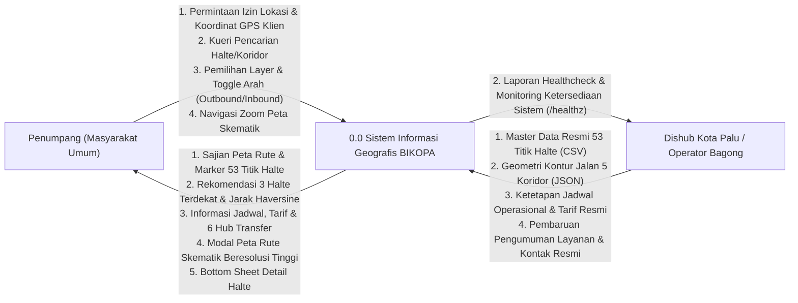
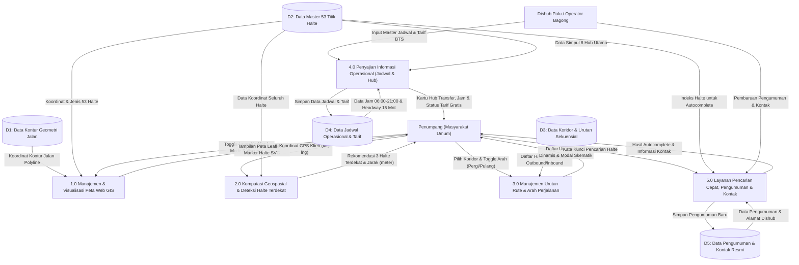
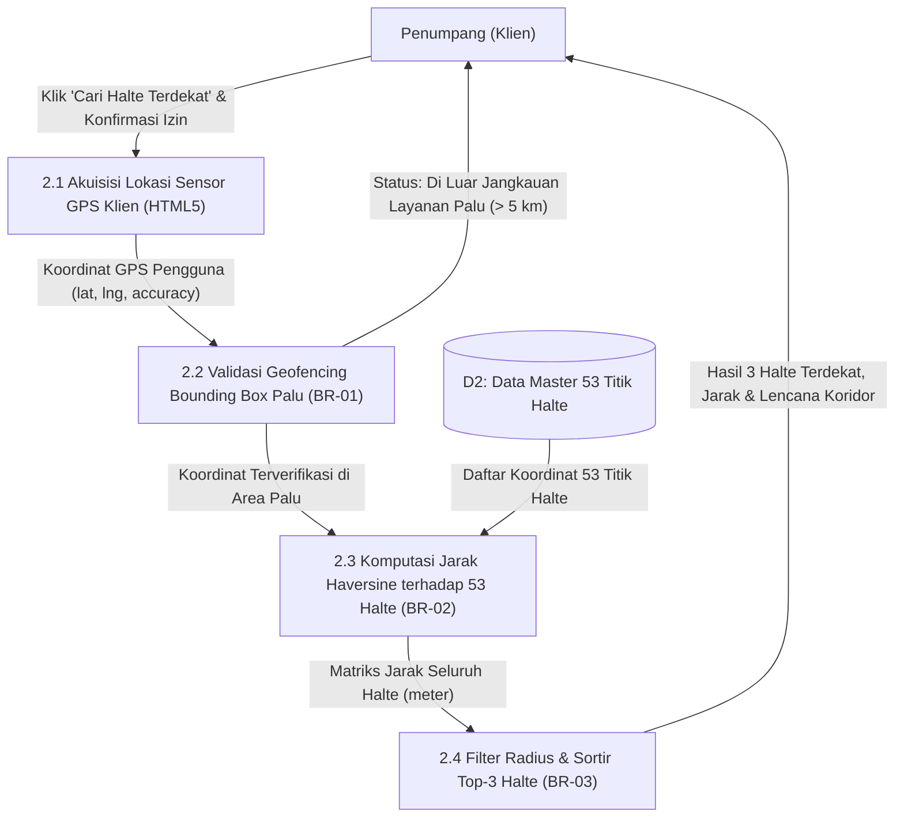
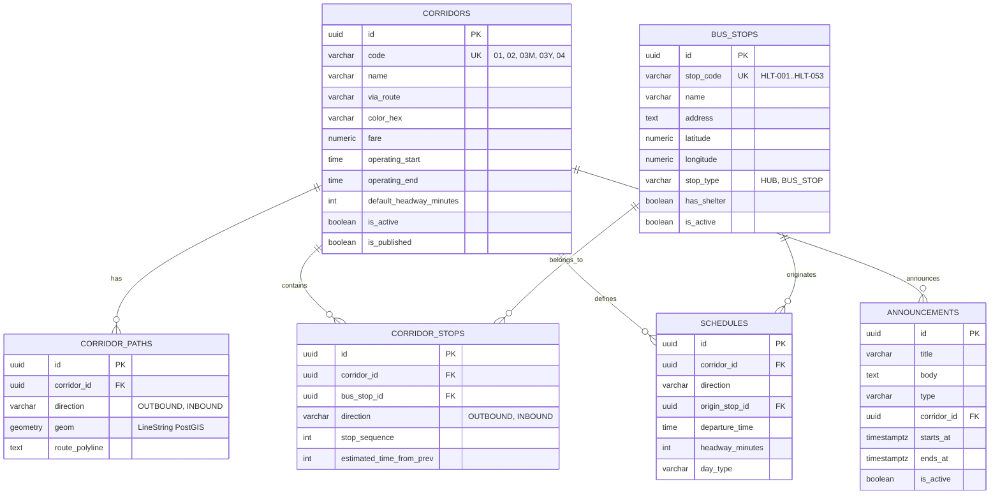

# DOKUMEN KEBUTUHAN PRODUK (PRD) & SPESIFIKASI TEKNIS SISTEM
# BIKOPA (Bis Kota Palu)
### Sistem Informasi Geografis (GIS) Rute, 53 Titik Halte, Jadwal, dan Hub Transfer Bus Trans Palu Berbasis Web Mobile-First

---

## LEMBAR PENGESAHAN & METADATA DOKUMEN

| Parameter | Keterangan / Nilai |
| :--- | :--- |
| **Nama Produk / Proyek** | **BIKOPA** *(Bis Kota Palu)* |
| **Deskripsi Layanan** | Sistem Informasi Geografis (GIS) Publik Mobile-First untuk Navigasi Rute Kontur Jalan, Pemetaan 53 Titik Halte, Deteksi Halte Terdekat via GPS Pengguna, Jadwal Operasional, dan 6 Hub Transfer Bus Trans Palu |
| **Versi Dokumen** | **3.1 (As-Built Verified — Sesuai Implementasi Aktual)** |
| **Status Dokumen** | Disetujui / Selesai Dibangun *(Production-Ready Prototype)* |
| **Tanggal Pembaruan** | November 2026 |
| **Basis Wilayah Operasional** | Kota Palu, Provinsi Sulawesi Tengah (Zona Waktu WITA, `Asia/Makassar`, UTC+8) |
| **Institusi Akademik** | Program Studi S1 Teknik Informatika, Jurusan Teknologi Informasi, Fakultas Teknik, Universitas Tadulako |
| **Dosen Pengampu** | **Dr. Deny Wiria Nugraha, S.T., M.Eng.** |
| **Tim Pengembang (Kelompok 7)** | 1. **Muh. Fachri N** (NIM: F5512520094)<br>2. **Alifias** (NIM: F5512520099)<br>3. **Akhsan Maulana R.** (NIM: F5512530114) |
| **Stakeholder Eksternal** | Dinas Perhubungan (Dishub) Kota Palu & PT Bagong Dekaka Makmur *(Operator BTS Bagong Transport)* |

---

## DAFTAR ISI

1. [Ringkasan Eksekutif & Latar Belakang](#1-ringkasan-eksekutif--latar-belakang)
2. [Tujuan, Visi, dan Batasan Sistem (Scope of Work)](#2-tujuan-visi-dan-batasan-sistem-scope-of-work)
3. [Profil Pengguna & Karakteristik Operasional](#3-profil-pengguna--karakteristik-operasional)
4. [Spesifikasi Data Master Geospasial Kota Palu](#4-spesifikasi-data-master-geospasial-kota-palu)
5. [Kebutuhan Fungsional (Functional Requirements — As-Built)](#5-kebutuhan-fungsional-functional-requirements--as-built)
6. [Kebutuhan Non-Fungsional (Non-Functional Requirements)](#6-kebutuhan-non-fungsional-non-functional-requirements)
7. [Aturan Bisnis (Business Rules) & Formulasi Algoritma](#7-aturan-bisnis-business-rules--formulasi-algoritma)
8. [Arsitektur Sistem & Pemodelan Proses (Data Flow Diagram — DFD)](#8-arsitektur-sistem--pemodelan-proses-data-flow-diagram--dfd)
   - 8.1 [Diagram Arsitektur Perangkat Lunak](#81-diagram-arsitektur-perangkat-lunak)
   - 8.2 [Diagram Konteks (DFD Level 0)](#82-diagram-konteks-dfd-level-0)
   - 8.3 [DFD Level 1 (Dekomposisi Fungsional Sistem BIKOPA)](#83-dfd-level-1-dekomposisi-fungsional-sistem-bikopa)
   - 8.4 [DFD Level 2 (Dekomposisi Proses Kunci)](#84-dfd-level-2-dekomposisi-proses-kunci)
   - 8.5 [Kamus Data Aliran Sistem (Data Flow Dictionary)](#85-kamus-data-aliran-sistem-data-flow-dictionary)
   - 8.6 [Struktur Direktori Proyek Aktual](#86-struktur-direktori-proyek-aktual)
9. [Perancangan Basis Data (Database Design)](#9-perancangan-basis-data-database-design)
10. [Spesifikasi Desain Antarmuka Pengguna (UI/UX Design Specification)](#10-spesifikasi-desain-antarmuka-pengguna-uiux-design-specification)
11. [Spesifikasi Antarmuka API (RESTful API Specification v1)](#11-spesifikasi-antarmuka-api-restful-api-specification-v1)
12. [Verifikasi, Pengujian, dan Validasi Sistem](#12-verifikasi-pengujian-dan-validasi-sistem)
13. [Matriks Keterlacutan Kebutuhan (Requirements Traceability Matrix — RTM)](#13-matriks-keterlacutan-kebutuhan-requirements-traceability-matrix--rtm)
14. [Rencana Pengembangan Masa Depan (Future Work Roadmap)](#14-rencana-pengembangan-masa-depan-future-work-roadmap)
15. [Panduan Pemanfaatan Dokumen untuk Penulisan Laporan](#15-panduan-pemanfaatan-dokumen-untuk-penulisan-laporan)

---

## 1. RINGKASAN EKSEKUTIF & LATAR BELAKANG

### 1.1 Latar Belakang Masalah
Kota Palu sebagai pusat pemerintahan, perdagangan, dan pendidikan tinggi di Provinsi Sulawesi Tengah terus mengalami peningkatan mobilitas penduduk. Untuk mengantisipasi kemacetan lalu lintas dan memulihkan ekosistem transportasi publik pasca rekonstruksi kota, Pemerintah Kota Palu bersama Kementerian Perhubungan meluncurkan layanan angkutan umum massal perkotaan **Bus Trans Palu** dengan skema *Buy The Service (BTS)* yang dioperasikan oleh **PT Bagong Dekaka Makmur (Bagong Transport)**.

Layanan Bus Trans Palu mengoperasikan armada bus modern berpendingin udara (AC), berkapasitas 35 penumpang, dengan ciri khas livery corak daun kelor keemasan yang melayani 5 koridor strategis. Namun, adopsi masyarakat dan efektivitas penggunaan angkutan umum ini masih mengalami kendala utama pada **ketersediaan informasi publik digital**:
1. **Ketiadaan Peta Jalur Mikro yang Terintegrasi:** Platform peta komersial umum (seperti Google Maps atau Moovit) belum memetakan seluruh rute mikro, 53 titik pemberhentian halte, dan 6 hub transfer Trans Palu secara detail, akurat, dan ramah pengguna lokal.
2. **Ketidaktahuan Lokasi Titik Halte Terdekat:** Masyarakat yang hendak naik bus sering kali tidak mengetahui di mana letak halte terdekat dari posisi mereka berada dan berapa meter jarak yang harus mereka tempuh untuk mencapai halte tersebut.
3. **Ketidakpastian Informasi Arah dan Urutan Halte:** Calon penumpang kerap ragu mengenai apakah suatu koridor melewati titik tujuan mereka pada rute *Pergi (Outbound)* atau rute *Pulang (Inbound)*.
4. **Friksi Akses Aplikasi (Wajib Unduh & Login):** Banyak aplikasi mobilitas perkotaan nasional mengharuskan pengguna mengunduh aplikasi *native* berukuran besar, membuat akun dengan email/nomor telepon, serta melakukan login dan verifikasi OTP yang merepotkan masyarakat hanya untuk sekadar mengecek rute atau jadwal.

### 1.2 Solusi yang Dihadirkan: BIKOPA
**BIKOPA (Bis Kota Palu)** dibangun sebagai platform Web GIS publik yang bersifat **mobile-first, instan, ringan, dan bebas friksi (Zero-Login / Tanpa Akun)**. BIKOPA menyediakan:
- **Visualisasi Peta Leaflet Interaktif:** Pemetaan 5 koridor bus Trans Palu dengan garis *polyline* yang presisi mengikuti kontur jalan raya nyata Kota Palu (*street-contour precision*).
- **Deteksi Halte Terdekat Berbasis GPS Klien:** Mengakses sensor GPS bawaan ponsel pengguna (*HTML5 Geolocation API*) untuk mengomputasi jarak ke seluruh halte menggunakan formula Haversine secara instan di peramban tanpa membocorkan privasi lokasi pengguna ke server.
- **Navigasi Sekuensial Halte & Toggle Arah:** Urutan halte lengkap yang dapat dialihkan secara dinamis antara arah *Pergi (Outbound)* dan arah *Pulang (Inbound)*.
- **Modal Peta Rute Skematik Interaktif:** Fasilitas peninjauan visual grafis peta skematik rute yang dilengkapi kontrol pembesaran (*Zoom In*, *Zoom Out*, dan *Reset Zoom*).
- **Informasi Operasional Lengkap:** Panduan jam operasional (06:00–21:00 WITA), interval keberangkatan bus (*headway* 15 menit), tarif resmi (Gratis uji coba BTS), dan panduan 6 simpul transfer utama (*Hub Cards*).

---

## 2. TUJUAN, VISI, DAN BATASAN SISTEM (SCOPE OF WORK)

### 2.1 Tujuan Produk
1. **Mengeliminasi Hambatan Informasi Transportasi Publik:** Menyediakan panduan rute, 53 titik halte, dan 6 hub transfer yang dapat diakses langsung oleh masyarakat dalam waktu `< 2,5 detik` melalui web browser perangkat genggam tanpa instalasi aplikasi.
2. **Memudahkan Penumpang Menemukan Titik Naik Terdekat:** Menyajikan 3 rekomendasi halte terdekat dari koordinat fisik pengguna secara akurat beserta visualisasi jarak dalam satuan meter.
3. **Memberikan Kepastian Urutan Perjalanan:** Menampilkan urutan sekuensial halte untuk kedua arah perjalanan (Outbound & Inbound) guna menghindari kesalahan menaiki bus.
4. **Mendukung Program Angkutan Massal Kota Palu:** Membantu Dinas Perhubungan Kota Palu dan operator PT Bagong Transport dalam meningkatkan keterbacaan rute bagi komuter, pelajar, mahasiswa, dan wisatawan.

### 2.2 Batasan Ruang Lingkup (Scope of Work)

```
┌────────────────────────────────────────────────────────────────────────┐
│                        RUANG LINGKUP SISTEM BIKOPA                     │
├───────────────────────────────────┬────────────────────────────────────┤
│       DALAM LINGKUP (IN-SCOPE)    │     DI LUAR LINGKUP (OUT-OF-SCOPE) │
│       Implementasi Aktual Selesai │    Bukan Bagian Sistem Versi Ini   │
├───────────────────────────────────┼────────────────────────────────────┤
│ • Peta Leaflet Web GIS Interaktif │ • Pelacakan GPS Armada Bus Live    │
│ • Kontur jalan raya nyata 5 rute  │   (Belum ada open API GPS Bus BTS) │
│ • Filter layer koridor on/off     │ • Sistem registrasi / login user   │
│ • Deteksi GPS Halte Terdekat      │ • E-ticketing / Pembayaran QRIS    │
│ • Algoritma Haversine & Geofence  │ • Aplikasi native khusus Driver    │
│ • Urutan Halte Outbound & Inbound │ • Panel CMS / Admin berbasis web   │
│ • Modal Peta Skematik Zoomable    │ • Notifikasi marketing / broadcast │
│ • Tabs Jadwal, Tarif & Halte      │ • Perencana rute multimoda non-bus │
│ • Akses Cepat 6 Hub Antarmoda     │ • Pengumpulan riwayat lokasi user  │
│ • Banner Profil Spesifikasi Bus   │                                    │
│ • RESTful API Data Service v1     │                                    │
└───────────────────────────────────┴────────────────────────────────────┘
```

> [!NOTE]
> **Klarifikasi Ruang Lingkup Pelacakan Bus (Live Bus Tracking):**
> Sistem BIKOPA pada versi ini **tidak menampilkan pelacakan posisi fisik bus berjalan secara *live* di peta**. Hal ini disebabkan oleh ketiadaan akses gerbang API telemetri (*Open GTFS-RT feed* / *IoT Gateway*) yang disediakan oleh pihak regulator atau operator armada kepada publik. Seluruh fitur navigasi berfokus penuh pada penyajian geospasial rute jalan, 53 titik halte resmi, deteksi halte terdekat via GPS pengguna, serta jadwal operasional resmi.

### 2.3 Prinsip Rekayasa (Design Principles)
* **Zero Friction (No Login):** Seluruh data rute, jadwal, dan halte dapat diakses oleh publik tanpa formulir, nomor telepon, atau kata sandi.
* **Mobile-First Responsive:** Desain antarmuka dioptimalkan secara mutlak untuk perangkat genggam dengan lebar layar mulai dari 360 px hingga layar desktop lebar.
* **Geospatial Precision:** Jalur bus tidak digambar menggunakan garis lurus antarhalte, melainkan menggunakan data koordinat jalan raya nyata (*street-contour polyline*).
* **Privacy by Design:** Lokasi GPS pengguna hanya diproses di memori browser lokal (*client-side execution*) untuk menghitung jarak ke halte terdekat menggunakan formula Haversine, dan tidak pernah direkam atau dikirimkan ke server.

---

## 3. PROFIL PENGGUNA & KARAKTERISTIK OPERASIONAL

### 3.1 Target Audiens / Persona Pengguna
1. **Komuter Harian & Masyarakat Umum:** Warga Kota Palu yang bepergian dari perumahan ke tempat kerja, pusat perbelanjaan (Pasar Manonda, Palu Plaza, PGM), fasilitas kesehatan (RS Undata, RS Bhayangkara, Puskesmas), atau kantor pemerintahan.
2. **Mahasiswa & Pelajar:** Mahasiswa Universitas Tadulako (Untad) dan Universitas Terbuka, serta siswa SMAN 1, SMPN 2, SMPN 3 Palu yang membutuhkan kepastian rute dan titik pemberhentian terdekat dengan biaya perjalanan hemat.
3. **Wisatawan & Pendatang:** Penumpang yang baru tiba di Bandara Mutiara SIS Al-Jufri, Pelabuhan Pantoloan, atau Terminal Bus Tipo yang memerlukan panduan transportasi umum menuju pusat kota.

### 3.2 Lingkungan Operasional
* **Sistem Operasi Klien:** Android 8.0+, iOS 13+, Windows 10/11, macOS, Linux.
* **Peramban Web:** Google Chrome, Mozilla Firefox, Safari, Microsoft Edge, Opera (mendukung ES6+, CSS Grid/Flexbox, dan HTML5 Geolocation API).
* **Resolusi Layar:** Responsif dari lebar 360 px (smartphone compact), 768 px (tablet), hingga 1920 px (desktop).
* **Kondisi Jaringan:** Dapat beroperasi pada koneksi seluler 3G/4G/5G dengan latensi bervariasi di area pesisir Teluk Palu hingga perbukitan.

---

## 4. SPESIFIKASI DATA MASTER GEOSPASIAL KOTA PALU

### 4.1 Koridor Resmi Bus Trans Palu
BIKOPA mengelola 5 koridor resmi yang melintasi penjuru Kota Palu:

| Kode | Nama Koridor Resmi | Jalur Lintasan Utama | Jumlah Halte | Hub Kunci | Warna Data |
| :---: | :--- | :--- | :---: | :--- | :---: |
| **01** | **Pantoloan – Pusat Kota** | Jalur arteri Trans Sulawesi – Pantoloan – Tawaeli – Untad – Pusat Kota | 19 Halte | Pelabuhan Pantoloan, Taman GOR | `#EF4444` *(Merah)* |
| **02** | **Balai Kota – Pasar Manonda** | Balai Kota – Pusat Kota – Palu Barat – Pasar Inpres Manonda | 18 Halte | Taman GOR, Balai Kota, Pasar Inpres Manonda | `#3B82F6` *(Biru)* |
| **03M** | **Pusat Kota – Bandara MSA** | Pusat Kota menuju Bandara MSA via Jl. Wolter Monginsidi | 9 Halte | Taman GOR, Bandara Mutiara SIS Al-Jufri | `#10B981` *(Hijau)* |
| **03Y** | **Pusat Kota – Bandara MSA** | Pusat Kota menuju Bandara MSA via Jl. Prof. Moh. Yamin | 11 Halte | Taman GOR, Balai Kota, Bandara Mutiara SIS Al-Jufri | `#F59E0B` *(Oranye)* |
| **04** | **Bandara MSA – Terminal Tipo** | Bandara – Jl. I Gusti Ngurah Rai – Jembatan Palu IV / Jalur Dalam – Terminal Tipo | 10 Halte | Bandara Mutiara SIS Al-Jufri, Terminal Tipo | `#8B5CF6` *(Ungu)* |

### 4.2 Simpul Strategis (6 Hub Transfer Utama)
Hub adalah titik temu strategis antarkoridor yang memungkinkan pertukaran moda atau transit antar rute:
1. **HLT-001 (Pelabuhan Pantoloan):** Hub maritim pintu masuk utara Palu (Koridor 01).
2. **HLT-002 (Taman GOR):** Super-hub jantung kota yang mempertemukan Koridor 01, 02, 03M, dan 03Y.
3. **HLT-003 (Balai Kota):** Hub pusat pemerintahan Kota Palu (Koridor 02 dan 03Y).
4. **HLT-004 (Pasar Inpres Manonda):** Hub ekonomi pasar induk terbesar Palu Barat (Koridor 02).
5. **HLT-005 (Bandara Mutiara SIS Al-Jufri):** Hub gerbang udara kota yang melayani Koridor 03M, 03Y, dan 04.
6. **HLT-006 (Terminal Tipo):** Hub gerbang darat barat Palu menuju Donggala / Makassar (Koridor 04).

### 4.3 Master Data 53 Titik Halte Trans Palu
Data halte bersumber langsung dari pemetaan resmi Dishub Kota Palu (`titik_halte_trans_palu.csv`):

| Kode | Nama Halte | Tipe | Koridor yang Melayani | Latitude | Longitude |
| :---: | :--- | :---: | :--- | :---: | :---: |
| **HLT-001** | Pelabuhan Pantoloan | HUB | 01 | -0.71383500 | 119.85502600 |
| **HLT-002** | Taman GOR | HUB | 01, 02, 03M, 03Y | -0.89700300 | 119.87702200 |
| **HLT-003** | Balai Kota | HUB | 02, 03Y | -0.90382300 | 119.89721000 |
| **HLT-004** | Pasar Inpres Manonda | HUB | 02 | -0.91350600 | 119.86608500 |
| **HLT-005** | Bandara Mutiara SIS Al-Jufri | HUB | 03M, 03Y, 04 | -0.91605300 | 119.90799700 |
| **HLT-006** | Terminal Tipo | HUB | 04 | -0.89973200 | 119.82686800 |
| **HLT-007** | Puskesmas Tawaeli | BUS_STOP | 01 | -0.72591600 | 119.86968000 |
| **HLT-008** | Puskesmas Kayumalue | BUS_STOP | 01 | -0.76008700 | 119.86708000 |
| **HLT-009** | Taipa Beach | BUS_STOP | 01 | -0.79361600 | 119.87673500 |
| **HLT-010** | Brimob | BUS_STOP | 01 | -0.83401500 | 119.88876400 |
| **HLT-011** | Terminal Mamboro | BUS_STOP | 01 | -0.81432200 | 119.88242100 |
| **HLT-012** | Huntap Tondo 1 | BUS_STOP | 01 | -0.84074200 | 119.88720400 |
| **HLT-013** | Islamic Center Untad | BUS_STOP | 01 | -0.85408500 | 119.88849700 |
| **HLT-014** | Universitas Terbuka | BUS_STOP | 01 | -0.84752500 | 119.89066600 |
| **HLT-015** | Undata | BUS_STOP | 01 | -0.86503600 | 119.88102300 |
| **HLT-016** | Puskesmas Talise | BUS_STOP | 01 | -0.88092200 | 119.88280600 |
| **HLT-017** | Polresta | BUS_STOP | 01 | -0.89201900 | 119.87978000 |
| **HLT-018** | Korem | BUS_STOP | 01, 02 | -0.89668500 | 119.86991000 |
| **HLT-019** | Titik 0 Km | BUS_STOP | 01, 02 | -0.89694200 | 119.86883200 |
| **HLT-020** | Telkom | BUS_STOP | 02 | -0.89945200 | 119.87652700 |
| **HLT-021** | Moh Hatta | BUS_STOP | 02 | -0.89808300 | 119.87440600 |
| **HLT-022** | Hasanuddin | BUS_STOP | 02 | -0.89647200 | 119.86695200 |
| **HLT-023** | Gajah Mada | BUS_STOP | 02 | -0.89508300 | 119.86237100 |
| **HLT-024** | Sis Aljufri | BUS_STOP | 02 | -0.89904200 | 119.86088200 |
| **HLT-025** | SMPN 3 | BUS_STOP | 02 | -0.90606400 | 119.86178300 |
| **HLT-026** | Anutapura | BUS_STOP | 02 | -0.90562200 | 119.86470800 |
| **HLT-027** | Masjid Raya | BUS_STOP | 02 | -0.90150900 | 119.86548700 |
| **HLT-028** | Wahid Hasyim | BUS_STOP | 02 | -0.89704200 | 119.86500500 |
| **HLT-029** | Kimaja | BUS_STOP | 02 | -0.89196100 | 119.86749300 |
| **HLT-030** | Hi Hayun | BUS_STOP | 02 | -0.89304200 | 119.87352800 |
| **HLT-031** | SMPN 2 | BUS_STOP | 02 | -0.89718400 | 119.87955500 |
| **HLT-032** | Kartini | BUS_STOP | 02 | -0.90098400 | 119.88242100 |
| **HLT-033** | Puskesmas Birobuli | BUS_STOP | 03M, 03Y | -0.91696200 | 119.90234400 |
| **HLT-034** | Basrah 1 | BUS_STOP | 03M, 03Y | -0.91702400 | 119.89702200 |
| **HLT-035** | Basrah 2 | BUS_STOP | 03M, 03Y | -0.91710500 | 119.89201500 |
| **HLT-036** | TMP | BUS_STOP | 03M, 03Y | -0.91708400 | 119.88703400 |
| **HLT-037** | 711 | BUS_STOP | 03M, 03Y | -0.91402200 | 119.88506200 |
| **HLT-038** | Pasar Masomba | BUS_STOP | 03M, 03Y | -0.90805300 | 119.88401900 |
| **HLT-039** | Monginsidi | BUS_STOP | 03M | -0.90204200 | 119.88102300 |
| **HLT-040** | KPP Pratama | BUS_STOP | 03Y | -0.90703300 | 119.89854400 |
| **HLT-041** | Kejaksaan | BUS_STOP | 03Y | -0.90401500 | 119.89901500 |
| **HLT-042** | Rumah Sakit Bayangkara | BUS_STOP | 01 | -0.89004200 | 119.87502400 |
| **HLT-043** | Tombolututu | BUS_STOP | 01 | -0.88502300 | 119.87705500 |
| **HLT-044** | Inspektorat | BUS_STOP | 01 | -0.88804200 | 119.87602300 |
| **HLT-045** | SMAN 1 | BUS_STOP | 01 | -0.89401500 | 119.87201500 |
| **HLT-046** | Silae | BUS_STOP | 04 | -0.89304200 | 119.83502200 |
| **HLT-047** | PGM | BUS_STOP | 04 | -0.88801500 | 119.84201500 |
| **HLT-048** | Palu Plaza | BUS_STOP | 04 | -0.89203300 | 119.85102400 |
| **HLT-049** | Pue Bongo 1 | BUS_STOP | 04 | -0.91004200 | 119.85501500 |
| **HLT-050** | Pue Bongo 2 | BUS_STOP | 04 | -0.90501500 | 119.85302200 |
| **HLT-051** | Bundaran Palupi | BUS_STOP | 04 | -0.91802200 | 119.86501500 |
| **HLT-052** | Pasar TavanJuka | BUS_STOP | 04 | -0.92004200 | 119.87502200 |
| **HLT-053** | Puskesmas Mabelopura | BUS_STOP | 04 | -0.92201500 | 119.88501500 |

### 4.4 Geometri Kontur Jalan Raya (Street-Contour Precision)
BIKOPA mengintegrasikan data `corridor-road-routes.json` yang menyimpan rangkaian titik koordinat presisi tinggi (*latitude, longitude*) yang merefleksikan geometri jalanan Kota Palu secara nyata:
- Menghilangkan anomali garis lurus yang memotong pemukiman, laut teluk, atau perbukitan.
- Rute koridor otomatis digambar secara mulus di atas layer OpenStreetMap pada komponen Leaflet dengan casing putih tebal sebagai outline kontras.

---

## 5. KEBUTUHAN FUNGSIONAL (FUNCTIONAL REQUIREMENTS — AS-BUILT)

Berikut adalah daftar spesifikasi kebutuhan fungsional yang **telah selesai dibangun dan beroperasi penuh secara nyata** di dalam sistem website BIKOPA:

| Kode FR | ID User Story | Nama Fitur | Deskripsi Fungsional & Kriteria Penerimaan (*Acceptance Criteria*) | Komponen Implementasi | Status |
| :---: | :---: | :--- | :--- | :--- | :---: |
| **FR-01** | US-01 | **Peta Rute Interaktif Web GIS Leaflet** | Menampilkan peta Kota Palu berbasis Leaflet dengan garis polyline jalan raya berwarna resmi per koridor. Pengguna dapat melakukan zoom, pan, toggle nyala/mati layer koridor, serta masuk ke mode layar penuh (*fullscreen*). Marker halte menggunakan ikon bus SVG dengan pembeda warna koridor dan ukuran lebih besar untuk tipe HUB. | `src/components/LeafletMap.tsx`, `src/components/MapPreview.tsx` | **100% Selesai** |
| **FR-02** | US-02 | **Deteksi Halte Terdekat via GPS Pengguna** | Mengakses sensor HTML5 Geolocation API (`watchPosition`) dengan opsi *high-accuracy*. Menampilkan pin lokasi pengguna dengan animasi gelombang pulse dan lingkaran radius akurasi GPS di peta. Menghitung jarak ke seluruh 53 halte secara instan dengan formula Haversine di sisi peramban, serta menampilkan 3 halte terdekat secara terurut. | `src/components/LocationConsent.tsx`, `src/lib/geo/index.ts`, `src/components/MapPreview.tsx` | **100% Selesai** |
| **FR-03** | US-03 | **Navigasi Sekuensial & Toggle Arah Halte** | Menampilkan urutan halte dari halte awal hingga akhir per koridor. Dilengkapi kontrol toggle interaktif *Pergi (OUTBOUND)* dan *Pulang (INBOUND)* yang secara dinamis membalik urutan perjalanan serta nomor sekuens halte. | `src/lib/data/routes.ts`, `src/app/koridor/[code]/page.tsx` | **100% Selesai** |
| **FR-04** | US-04 | **Penyajian Jadwal Operasional & Tarif** | Menampilkan jam operasional resmi (06:00 – 21:00 WITA), interval kedatangan (*headway* 15 menit), jenis hari operasi (Setiap Hari), serta status tarif (Gratis masa BTS Rp 0,00) melalui kartu jadwal dan tab informasi. | `src/components/InfoTabs.tsx`, `src/lib/data/schedules.ts`, `src/lib/data/corridors.ts` | **100% Selesai** |
| **FR-05** | US-05 | **Modal Rute Skematik Interaktif** | Modal pop-up yang menyajikan gambar peta skematik rute bus Trans Palu (`/images/routes/{code}.png`). Dilengkapi tombol kontrol pembesaran: *Zoom In* (+30%), *Zoom Out* (-30%), *Reset Zoom* (100%), tab berganti koridor terpadu, dan penutupan dengan tombol ESC / klik backdrop. | `src/components/RouteModal.tsx` | **100% Selesai** |
| **FR-06** | US-06 | **Pencarian Cepat Halte & Koridor** | Fitur pencarian instan dengan *autocomplete* pada Hero Section untuk mencari halte berdasarkan nama atau koridor. Memilih item hasil pencarian akan langsung membuka modal halte atau mengarahkan ke koordinat halte terkait. | `src/components/QuickSearchBar.tsx`, `src/lib/route-search.ts` | **100% Selesai** |
| **FR-07** | US-07 | **Bottom Sheet Informasi Halte Cepat** | Menampilkan panel kartu informasi meluncur (*slide-up bottom sheet*) ketika pengguna mengeklik marker halte pada peta Leaflet atau kartu hub, memuat nama halte, kode halte, jenis halte, koridor yang melintas, serta tautan menuju halaman detail. | `src/components/StopSheet.tsx` | **100% Selesai** |
| **FR-08** | US-08 | **Halaman Detail Dinamis Halte & Koridor** | Halaman khusus dengan dynamic routing Next.js (`/halte/[code]` dan `/koridor/[code]`) yang menyajikan detail mendalam mengenai informasi geospasial halte, koneksi koridor, serta lintasan jalan rute. | `src/app/halte/[code]/page.tsx`, `src/app/koridor/[code]/page.tsx` | **100% Selesai** |
| **FR-09** | US-09 | **Kartu Pintas 6 Hub Transfer Antarmoda** | Bagian antarmuka yang menyajikan 6 simpul transfer utama lengkap dengan indikator jadwal 15 menit, koridor yang saling berpotongan, serta integrasi klik langsung ke bottom sheet halte terkait. | `src/components/HubCards.tsx` | **100% Selesai** |
| **FR-10** | US-10 | **Banner Profil & Spesifikasi Armada** | Banner informatif yang menyajikan ringkasan 4 metrik armada Bus Trans Palu: kapasitas 35 penumpang, livery putih-emas, 5 koridor, dan 53 halte, dilengkapi visual foto armada bus BTS dan tombol aksi ke peta/koridor. | `src/components/LiveBanner.tsx` | **100% Selesai** |
| **FR-11** | US-11 | **Pengumuman Layanan & Kontak Resmi Dishub** | Komponen banner strip pengumuman operasional kedinasan (`AnnouncementStrip`) serta section kontak resmi Dinas Perhubungan Kota Palu (alamat Jl. Balai Kota Timur No. 1, telepon 0451-421666) dan operator armada. | `src/components/AnnouncementStrip.tsx`, `src/components/ContactSection.tsx`, `src/components/SiteFooter.tsx` | **100% Selesai** |
| **FR-12** | US-12 | **RESTful API Data Service & Healthcheck** | Endpoint backend Next.js API route handlers untuk melayani pembacaan data koridor, halte, pencarian halte terdekat, jadwal, pengumuman, dan health check server (`/healthz`). | `src/app/api/v1/...`, `src/app/healthz/route.ts` | **100% Selesai** |

---

## 6. KEBUTUHAN NON-FUNGSIONAL (NON-FUNCTIONAL REQUIREMENTS)

### 6.1 Kinerja (Performance)
* **NFR-01 (Waktu Pemuatan Awal):** Halaman beranda wajib dapat berinteraksi (*Time to Interactive*) dalam waktu `< 2,5 detik` pada koneksi seluler 4G reguler.
* **NFR-02 (Bundle Size Efisien):** Modul Leaflet dimuat secara dinamis (*lazy dynamic import*) dengan penonaktifan SSR (`ssr: false`) sehingga muatan JavaScript awal berukuran ringan dan tidak membebani memori ponsel.
* **NFR-03 (Responsivitas API):** Endpoint API lokal Next.js merespons permintaan data (*read operations*) dengan latensi $p95 < 150\text{ ms}$.

### 6.2 Aksesibilitas & Usability
* **NFR-04 (Kontras Warna Standar WCAG 2.1 AA):** Seluruh teks dan tombol memiliki rasio kontras minimal 4,5:1 terhadap latar belakang untuk kenyamanan pandangan di luar ruangan.
* **NFR-05 (Touch Target Standar Mobile):** Seluruh elemen yang dapat diklik atau disentuh (tombol, tab, tautan, marker) memiliki dimensi area sentuh minimal $44 \times 44\text{ piksel}$ sesuai standar Google Material Design dan Apple HIG.
* **NFR-06 (Keyboard Accessibility):** Komponen modal (`RouteModal`) mendukung navigasi aksesibilitas keyboard melalui penekanan tombol `Escape` untuk menutup secara instan.

### 6.3 Keamanan & Privasi Pengguna
* **NFR-07 (Zero Data Leakage / Tanpa Akun):** Sistem tidak menyediakan form registrasi, tidak meminta email, nama, atau kata sandi, sehingga tidak memiliki risiko kebocoran data identitas pengguna (*Zero PII*).
* **NFR-08 (Privasi Geospasial Klien):** Koordinat GPS pengguna hanya dieksekusi di peramban lokal perangkat pengguna (*ephemeral client-side*) dan tidak pernah dikirimkan atau disimpan ke dalam basis data server.

### 6.4 Kompatibilitas & Portabilitas
* **NFR-09 (Cross-Platform Responsive):** Tata letak antarmuka mendukung breakpoint responsif Tailwind CSS:
  - Mobile Small: $\ge 360\text{ px}$
  - Mobile Regular: $\ge 640\text{ px}$ (`sm`)
  - Tablet: $\ge 768\text{ px}$ (`md`)
  - Desktop: $\ge 1024\text{ px}$ (`lg`)
  - Widescreen: $\ge 1280\text{ px}$ (`xl`)

---

## 7. ATURAN BISNIS (BUSINESS RULES) & FORMULASI ALGORITMA

### 7.1 BR-01: Validasi Batas Wilayah Operasional (Bounding Box Kota Palu)
Setiap koordinat geografis yang diperiksa oleh sistem harus berada di dalam batas toleransi koordinat geografis Kota Palu:
$$\text{Latitude} \in [-1.00, -0.65], \quad \text{Longitude} \in [119.75, 119.97]$$
*Jika koordinat berada di luar rentang tersebut, sistem akan mengidentifikasi bahwa pengguna berada di luar area jangkauan operasional Bus Trans Palu.*

### 7.2 BR-02: Algoritma Jarak Lingkaran Besar (Haversine Formula)
Untuk menghitung jarak permukaan bumi antara lokasi pengguna $(lat_1, lon_1)$ dengan koordinat halte $(lat_2, lon_2)$ tanpa membebani server dengan query spasial berat:

$$\Delta\phi = \frac{(lat_2 - lat_1) \cdot \pi}{180}, \quad \Delta\lambda = \frac{(lon_2 - lon_1) \cdot \pi}{180}$$
$$a = \sin^2\left(\frac{\Delta\phi}{2}\right) + \cos\left(\frac{lat_1 \cdot \pi}{180}\right) \cdot \cos\left(\frac{lat_2 \cdot \pi}{180}\right) \cdot \sin^2\left(\frac{\Delta\lambda}{2}\right)$$
$$c = 2 \cdot \text{atan2}(\sqrt{a}, \sqrt{1-a})$$
$$d = \text{round}(R \cdot c) \quad \text{dengan } R = 6.371.000\text{ meter}$$

### 7.3 BR-03: Aturan Rekomendasi Halte Terdekat (Nearby Radius Filter)
- Radius pencarian maksimal: $5000\text{ meter}$ (5 km).
- Jumlah maksimum halte terdekat yang disajikan: 3 halte teratas (diurutkan dari jarak terkecil / *ascending*).
- Jika jarak ke halte terdekat melebihi $5000\text{ meter}$, sistem menandai `isOutOfServiceArea = true` ("Di luar jangkauan layanan").
- Halte yang melayani lebih dari satu koridor (seperti Taman GOR atau Bandara MSA) **hanya ditampilkan satu kali** dengan menampilkan lencana seluruh koridor yang beririsan.

### 7.4 BR-04: Aturan Urutan Sekuensial Halte & Toggle Arah
- Setiap koridor memiliki dua varian urutan perjalanan:
  1. **`OUTBOUND` (Pergi):** Urutan sekuensial normal dari terminal/halte awal menuju halte akhir.
  2. **`INBOUND` (Pulang):** Urutan sekuensial yang dibalik (*reversed sequence*) merefleksikan arah kepulangan bus.
- Nomor urut halte dinamis diperbarui secara otomatis saat pengguna menekan tombol pengalih arah.

---

## 8. ARSITEKTUR SISTEM & PEMODELAN PROSES (DATA FLOW DIAGRAM — DFD)

### 8.1 Diagram Arsitektur Perangkat Lunak

```
┌────────────────────────────────────────────────────────────────────────┐
│                        LAPISAN KLIEN (PERAMBAN WEB)                    │
│  Next.js 14 App Router (React 18) • Tailwind CSS • Lucide Icons       │
│                                                                        │
│  ┌──────────────────┐  ┌───────────────────┐  ┌─────────────────────┐  │
│  │ LeafletMap (GIS) │  │ RouteModal (Zoom) │  │  InfoTabs & Hubs    │  │
│  └────────▲─────────┘  └───────────────────┘  └─────────────────────┘  │
│           │                                                            │
│  ┌────────┴─────────┐  ┌───────────────────┐  ┌─────────────────────┐  │
│  │ HTML5 Geolocation│  │ Haversine Engine  │  │ StopSheet (Drawer)  │  │
│  └──────────────────┘  └───────────────────┘  └─────────────────────┘  │
└───────────────────────────────────┬────────────────────────────────────┘
                                    │ HTTP Fetch (Internal API)
┌───────────────────────────────────▼────────────────────────────────────┐
│                     LAPISAN SERVER (NEXT.JS RUNTIME)                   │
│                                                                        │
│  ┌──────────────────────────────────────────────────────────────────┐  │
│  │ REST API Route Handlers (/api/v1/...)                            │  │
│  │  • /corridors        • /stops         • /stops/nearby            │  │
│  │  • /schedules        • /announcements • /system-info             │  │
│  │  • /healthz (System Health Monitoring)                           │  │
│  └──────────────────────────────────▲───────────────────────────────┘  │
│                                     │ Read Master Data                 │
│  ┌──────────────────────────────────┴───────────────────────────────┐  │
│  │ DATA MASTER STATIS & GEOSPATIAL FILES                            │  │
│  │  • titik_halte_trans_palu.csv (53 Halte Resmi Dishub)            │  │
│  │  • corridor-road-routes.json (Polyline Kontur Jalan Palu)        │  │
│  │  • Master Koridor, Rute Sekuensial, Jadwal, & Kontak             │  │
│  └──────────────────────────────────────────────────────────────────┘  │
└────────────────────────────────────────────────────────────────────────┘
```

---

### 8.2 Diagram Konteks (DFD Level 0)

Diagram Konteks memodelkan batas sistem BIKOPA sebagai satu proses tunggal (*Proses 0.0*) yang berinteraksi dengan dua entitas eksternal: **Penumpang (Masyarakat Umum)** dan **Dishub Kota Palu / Operator Trans Palu**.



---

### 8.3 DFD Level 1 (Dekomposisi Fungsional Sistem BIKOPA)

DFD Level 1 menguraikan sistem BIKOPA menjadi 5 proses utama dan memetakan alirannya ke 5 penyimpanan data (*data stores*):



---

### 8.4 DFD Level 2 (Dekomposisi Proses Kunci)

#### 8.4.1 DFD Level 2 — Proses 2.0 (Layanan Geospasial & Deteksi Halte Terdekat)
Proses 2.0 didekomposisi menjadi 4 subproses spesifik yang merefleksikan alur kerja fitur pencarian halte terdekat:



* **Penjelasan Subproses 2.0:**
  1. *Subproses 2.1:* Mengaktifkan sensor GPS perangkat pengguna melalui `navigator.geolocation.watchPosition` dengan opsi `enableHighAccuracy: true` setelah pengguna menyetujui dialog persetujuan lokasi.
  2. *Subproses 2.2:* Memeriksa apakah koordinat pengguna berada dalam batas bounding box Kota Palu (BR-01). Jika berada di luar jangkauan, sistem langsung menetapkan status *Out of Service Area*.
  3. *Subproses 2.3:* Mengambil 53 data koordinat halte dari Data Store *D2* dan mengeksekusi perhitungan jarak lingkaran besar bumi menggunakan formula Haversine (BR-02) di memori lokal peramban.
  4. *Subproses 2.4:* Mengurutkan halte berdasarkan jarak terkecil (*ascending*), memfilter halte yang berada dalam batas toleransi radius 5000 meter, mengambil 3 halte teratas, dan menyatukan lencana koridor untuk halte bersama (BR-03).

---

### 8.5 Kamus Data Aliran Sistem (Data Flow Dictionary)

| Nama Arus Data | Sumber | Tujuan | Bentuk & Struktur Data | Keterangan |
| :--- | :--- | :--- | :--- | :--- |
| **Koordinat GPS Klien** | Penumpang (Klien) | Proses 2.0 | `{ latitude: float, longitude: float, accuracy: float, timestamp: int }` | Data koordinat posisi pembacaan sensor GPS perangkat pengguna |
| **Kueri Pencarian** | Penumpang (Klien) | Proses 5.0 | `{ query_text: string }` | Kata kunci nama halte atau nomor koridor yang dicari pada search bar |
| **Pilihan Layer & Arah** | Penumpang (Klien) | Proses 1.0, 3.0 | `{ visible_corridors: Record<string, boolean>, direction: "OUTBOUND" \| "INBOUND" }` | Pilihan filter layer koridor dan toggle arah perjalanan |
| **Data Kontur Jalan** | Data Store D1 | Proses 1.0 | `{ corridor_code: string, polyline: [lat, lng][] }` | Koordinat kontur jalan raya resmi dari `corridor-road-routes.json` |
| **Data 53 Titik Halte** | Data Store D2 | Proses 1.0, 2.0, 5.0 | `{ stop_code: string, name: string, latitude: float, longitude: float, stop_type: string, corridors: string[] }` | Master 53 titik halte resmi dan daftar koridor yang dilayani |
| **Data Urutan Rute** | Data Store D3 | Proses 3.0 | `{ corridor_code: string, direction: string, stops: [{ stop_code, name, sequence }] }` | Urutan halte sekuensial untuk arah Outbound dan Inbound |
| **Hasil 3 Halte Terdekat** | Proses 2.0 | Penumpang (Klien) | `{ stops: [{ stop: BusStop, distance_m: int }], isOutOfServiceArea: bool }` | Hasil kalkulasi 3 halte terdekat dengan jarak Haversine dalam satuan meter |
| **Info Jadwal, Tarif & Hub**| Proses 4.0 | Penumpang (Klien) | `{ operating_start: "06:00", operating_end: "21:00", headway: 15, fare: 0, hubs: Hub[] }` | Informasi operasional harian dan daftar 6 hub transfer antarmoda |

---

### 8.6 Struktur Direktori Proyek Aktual

```
D:\BIKOPA\
├── package.json                         # Dependensi Next.js 14, Leaflet, Tailwind CSS, TypeScript
├── tsconfig.json                        # Konfigurasi TypeScript strict mode
├── tailwind.config.js                   # Definisi token warna kustom & tipografi
├── titik_halte_trans_palu.csv           # Master data 53 halte resmi Dishub Kota Palu
│
├── src\
│   ├── app\                             # Next.js 14 App Router
│   │   ├── layout.tsx                   # Root layout, metadata HTML, font loader
│   │   ├── page.tsx                     # Halaman Beranda Utama BIKOPA
│   │   ├── globals.css                  # Global styles, token CSS, styling peta Leaflet
│   │   ├── error.tsx                    # Error boundary handler
│   │   ├── not-found.tsx                # Custom 404 page
│   │   ├── healthz\route.ts             # Health check endpoint runtime
│   │   ├── halte\[code]\page.tsx        # Halaman detail halte dinamis
│   │   ├── koridor\[code]\page.tsx      # Halaman detail rute koridor dinamis
│   │   ├── kontak\page.tsx              # Halaman pengalihan kontak resmi
│   │   └── api\v1\                      # RESTful Route Handlers
│   │       ├── corridors\route.ts
│   │       ├── corridors\[code]\stops\route.ts
│   │       ├── stops\route.ts
│   │       ├── stops\[code]\route.ts
│   │       ├── stops\nearby\route.ts
│   │       ├── schedules\route.ts
│   │       ├── announcements\route.ts
│   │       └── system-info\route.ts
│   │
│   ├── components\                      # Komponen Modular Antarmuka
│   │   ├── SiteHeader.tsx               # Navigasi atas, logo merek, tautan section
│   │   ├── SiteFooter.tsx               # Footer identitas, alamat Dishub, hak cipta
│   │   ├── HeroSection.tsx              # Hero display, pencarian instan, CTA rute
│   │   ├── CorridorGrid.tsx             # Grid 5 koridor interaktif dengan badge warna
│   │   ├── MapPreview.tsx               # Kontainer peta Leaflet & panel controller
│   │   ├── LeafletMap.tsx               # Core GIS Leaflet: layer, polyline, marker, GPS
│   │   ├── RouteModal.tsx               # Modal preview rute skematik dengan zoom control
│   │   ├── InfoTabs.tsx                 # Tab informasi Jadwal, Halte, dan Panduan
│   │   ├── HubCards.tsx                 # Kartu navigasi 6 Hub Transfer utama
│   │   ├── LiveBanner.tsx               # Banner informasi profil & spesifikasi armada
│   │   ├── StopSheet.tsx                # Bottom sheet info cepat halte
│   │   ├── QuickSearchBar.tsx           # Bar pencarian cepat berbasis autocomplete
│   │   ├── LocationConsent.tsx          # Dialog izin akses geolokasi GPS
│   │   ├── AnnouncementStrip.tsx        # Banner pengumuman layanan operasional
│   │   └── CloudDivider.tsx             # Elemen pemisah visual estetis
│   │
│   └── lib\                             # Core Business Logic & Master Data
│       ├── types.ts                     # TypeScript Interface & Zod Schemas
│       ├── route-search.ts              # Logika pencarian autocomplete
│       ├── geo\index.ts                 # Algoritma Haversine & Bounding Box Palu
│       └── data\                        # Data Master Statis Terverifikasi
│           ├── corridors.ts             # Metadata 5 koridor resmi
│           ├── stops.ts                 # 53 data halte hasil pemetaan CSV
│           ├── routes.ts                # Urutan sekuensial halte Outbound & Inbound
│           ├── corridor-road-routes.json# Polyline koordinat kontur jalan raya nyata Palu
│           ├── schedules.ts             # Jadwal operasional harian
│           ├── announcements.ts         # Data pengumuman Dishub
│           └── system-info.ts           # Metadata sistem & kontak operasional
│
├── supabase\migrations\
│   └── 20261028000000_bikopa_schema.sql # DDL Skema PostgreSQL + PostGIS + RLS
└── tests\
    └── geo.test.mjs                     # Unit testing logika geospasial Haversine & Geofence
```

---

## 9. PERANCANGAN BASIS DATA (DATABASE DESIGN)

Sistem BIKOPA dirancang menggunakan struktur data yang mendukung persistensi relasional geospasial pada engine **PostgreSQL 15 + PostGIS**, serta struktur *in-memory* yang sinkron pada runtime aplikasi Next.js.

### 9.1 Entity Relationship Diagram (ERD)



### 9.2 Kamus Data Entitas Utama
1. **Entitas `corridors`:** Menyimpan 5 data koridor resmi (`01`, `02`, `03M`, `03Y`, `04`), nama rute, lintasan utama, kode warna heksadesimal, jam awal/akhir operasi (`06:00:00` s/d `21:00:00`), dan headway (15 menit).
2. **Entitas `bus_stops`:** Menyimpan 53 titik halte resmi (`HLT-001` s/d `HLT-053`), nama halte, koordinat geospasial WGS84 (`latitude`, `longitude`), dan tipe halte (`HUB` atau `BUS_STOP`).
3. **Entitas `corridor_stops`:** Tabel perantara *many-to-many* yang menentukan urutan halte sekuensial per koridor dan per arah (`OUTBOUND` atau `INBOUND`).
4. **Entitas `corridor_paths`:** Menyimpan data polyline kontur jalan raya Kota Palu menggunakan tipe geometri `LineString` PostGIS.
5. **Entitas `schedules`:** Menyimpan informasi jadwal keberangkatan bus harian dan frekuensi interval.
6. **Entitas `announcements`:** Menyimpan pengumuman resmi kedinasan mengenai gangguan atau penyesuaian layanan Bus Trans Palu.

---

## 10. SPESIFIKASI DESAIN ANTARMUKA PENGGUNA (UI/UX DESIGN SPECIFICATION)

### 10.1 Token Desain & Palet Warna (Design Tokens)

| Token Warna | Nilai Heksadesimal | Peran & Penggunaan Visual |
| :--- | :---: | :--- |
| `--navy` | `#1B2D52` | Warna tema utama, latar header navigasi, kartu hero, judul teks primer |
| `--deep` | `#121E3A` | Latar belakang footer, dasar gradasi header |
| `--coral` | `#FF6B4A` | Warna aksen utama: tombol aksi primer (CTA), tab aktif, sorotan teks |
| `--sky` | `#4F9FE0` | Warna tombol aksi hero, lencana informasi, latar kartu profil armada |
| `--sun` | `#FFC233` | Lencana kartu hub, ring fokus navigasi |
| `--mist` | `#F3F6FB` | Latar belakang kontainer halaman sekunder, selang-seling kartu konten |
| `--ink` | `#17233F` | Warna teks tipografi paragraf utama pada latar terang |
| `--paper` | `#FFFFFF` | Latar dasar halaman putih bersih, kartu konten |

### 10.2 Tipografi Resmi
- **Display Heading:** `Barlow Condensed` (Weight 600, 700, 800; Uppercase) — Digunakan untuk judul section, penamaan koridor, dan nomor lambung.
- **Body & Controls:** `DM Sans` (Weight 400, 500, 700) — Digunakan untuk isi teks penjelasan, lencana informasi, dan kontrol tombol.
- **Navigasi & Subheading:** `Open Sans` (Weight 300, 400, 600) — Digunakan untuk breadcrumbs, header navigasi, dan jam operasional.

### 10.3 Fitur Antarmuka Utama & Perilaku Pengguna

#### 1. Kontrol Peta GIS Leaflet (`MapPreview` & `LeafletMap`)
- **Tampilan Multi-Layer:** Pengguna dapat mengaktifkan atau menonaktifkan koridor tertentu secara independen melalui chip filter warna.
- **Marker Halte SVG & Pop-up:** Mengklik marker halte memunculkan tooltip nama halte, kode halte, dan daftar koridor yang melintas, serta membuka *StopSheet*.
- **Mode Layar Penuh (Fullscreen):** Pengguna dapat memperluas kanvas peta hingga memenuhi layar ponsel untuk observasi rute yang lebih leluasa.
- **Pin Lokasi Pengguna:** Menampilkan titik lokasi presisi pengguna beserta bulatan radius akurasi GPS dan animasi denyut gelombang (*pulse ring*) saat tombol deteksi halte ditekan.

#### 2. Modal Preview Rute Skematik (`RouteModal`)
- Menyajikan grafik visual skematik dari jalur koridor yang dipilih (`/images/routes/{code}.png`).
- **Fasilitas Zoom Interaktif:** Tombol *Zoom In* ($+30\%$), *Zoom Out* ($-30\%$), dan *Reset Zoom* ($100\%$) dengan batas skala aman $0.8\times$ hingga $2.5\times$.
- **Navigasi Tab Terpadu:** Pengguna dapat beralih antar koridor (01, 02, 03M, 03Y, 04) langsung dari dalam jendela modal tanpa harus menutup modal terlebih dahulu.
- **Dukungan Aksesibilitas:** Penekanan tombol `Esc` pada keyboard atau klik di luar area modal (*backdrop*) akan menutup modal secara halus.

#### 3. Bottom Sheet Halte Cepat (`StopSheet`)
- Panel informasi meluncur dari bagian bawah (*slide-up bottom sheet*) saat pengguna memilih halte di peta.
- Memuat nama lengkap halte, kode HLT, status fasilitas (Hub/Halte), daftar koridor yang lewat beserta frekuensi 15 menit, dan tombol rute menuju halaman detail.

---

## 11. SPESIFIKASI ANTARMUKA API (RESTFUL API SPECIFICATION v1)

Seluruh endpoint backend beralamat di base path `/api/v1`, merespons format standar `application/json` dengan encoding UTF-8, dan menggunakan zona waktu WITA (`+08:00`).

### 11.1 Ringkasan Daftar Endpoint

| Method | Endpoint Path | Deskripsi Fungsi | Akses |
| :---: | :--- | :--- | :---: |
| `GET` | `/api/v1/corridors` | Mengambil daftar 5 koridor resmi beserta warna dan status | Publik |
| `GET` | `/api/v1/corridors/:code/stops` | Mengambil daftar halte berurut per koridor dan arah | Publik |
| `GET` | `/api/v1/stops` | Mengambil seluruh 53 data halte (dukung filter search `?q=`) | Publik |
| `GET` | `/api/v1/stops/:code` | Mengambil informasi detail satu halte berdasarkan kode | Publik |
| `GET` | `/api/v1/stops/nearby` | Mencari 3 halte terdekat berdasarkan koordinat pengguna | Publik |
| `GET` | `/api/v1/schedules` | Mengambil jadwal operasional, headway, dan tarif | Publik |
| `GET` | `/api/v1/announcements` | Mengambil pengumuman dan informasi gangguan operasional | Publik |
| `GET` | `/api/v1/system-info` | Mengambil metadata sistem dan kontak resmi Dishub | Publik |
| `GET` | `/healthz` | Health check ketersediaan server runtime | Publik |

### 11.2 Rincian Kontrak Endpoint Halte Terdekat (`GET /api/v1/stops/nearby`)
* **Query Parameters:**
  - `lat` (number, required): Lintang koordinat pengguna.
  - `lng` (number, required): Bujur koordinat pengguna.
  - `radius` (number, optional, default: 5000): Radius pencarian dalam meter.
  - `limit` (number, optional, default: 3): Jumlah hasil maksimal.
* **Contoh Respons Sukses (HTTP 200 OK):**
```json
{
  "user_location": { "lat": -0.8985, "lng": 119.8750 },
  "is_out_of_service_area": false,
  "stops": [
    {
      "stop_code": "HLT-020",
      "name": "Telkom",
      "distance_m": 195,
      "stop_type": "BUS_STOP",
      "corridors": ["02"]
    },
    {
      "stop_code": "HLT-002",
      "name": "Taman GOR",
      "distance_m": 278,
      "stop_type": "HUB",
      "corridors": ["01", "02", "03M", "03Y"]
    }
  ]
}
```

---

## 12. VERIFIKASI, PENGUJIAN, DAN VALIDASI SISTEM

Pengujian sistem BIKOPA dilakukan melalui pengujian unit logika geospasial dan pengujian fungsional antarmuka (black-box testing).

### 12.1 Hasil Pengujian Unit Geospasial (`tests/geo.test.mjs`)

| Kasus Uji | Skenario Uji | Masukan (*Input*) | Hasil yang Diharapkan | Status |
| :---: | :--- | :--- | :--- | :---: |
| **TC-GEO-01** | Validasi Bounding Box Palu (Taman GOR) | `lat: -0.897, lng: 119.877` | `isWithinKotaPalu() === true` | **LULUS (PASS)** |
| **TC-GEO-02** | Validasi Bounding Box Palu (Pantoloan) | `lat: -0.7138, lng: 119.855` | `isWithinKotaPalu() === true` | **LULUS (PASS)** |
| **TC-GEO-03** | Penolakan Koordinat Luar Kota (Jakarta) | `lat: -6.20, lng: 106.80` | `isWithinKotaPalu() === false` | **LULUS (PASS)** |
| **TC-GEO-04** | Akurasi Perhitungan Jarak Haversine | Taman GOR ke Balai Kota Palu | Jarak darat berkisar antara $2000 - 2600\text{ meter}$ | **LULUS (PASS)** |
| **TC-GEO-05** | Deteksi 3 Halte Terdekat (Taman GOR) | Lokasi dekat Taman GOR | `HLT-002` halte terdekat, `isOutOfServiceArea === false` | **LULUS (PASS)** |
| **TC-GEO-06** | Deteksi Luar Wilayah Layanan Halte | Koordinat di luar batas Palu | `isOutOfServiceArea === true`, stops kosong | **LULUS (PASS)** |

### 12.2 Hasil Pengujian Fungsional Antarmuka Pengguna (Black Box)

| Komponen UI | Skenario Interaksi | Respon Antarmuka Aktual | Kesimpulan |
| :--- | :--- | :--- | :---: |
| **Filter Koridor** | Menyalakan/mematikan chip koridor 01 | Garis rute merah dan marker halte koridor 01 disembunyikan/ditampilkan di peta | **Sesuai** |
| **Halte Terdekat** | Menekan tombol "Cari Halte Terdekat" | Browser meminta izin GPS; peta bergeser ke lokasi pengguna dan menampilkan 3 halte terdekat | **Sesuai** |
| **Modal Rute** | Membuka modal rute dan menekan tombol Zoom In | Citra peta rute membesar $30\%$ secara proporsional | **Sesuai** |
| **Aksesibilitas** | Menekan tombol keyboard `Escape` saat modal aktif | Jendela modal tertutup dan scroll halaman kembali normal | **Sesuai** |
| **Arah Koridor** | Mengubah toggle arah ke *Pulang (INBOUND)* | Urutan halte pada daftar rute berbalik urutan dari akhir ke awal | **Sesuai** |
| **Responsif Ponsel**| Dibuka pada viewport $360 \times 640\text{ px}$ | Seluruh kartu dan tombol tertata rapi tanpa *horizontal overflow* | **Sesuai** |

---

## 13. MATRIKS KETERLACUTAN KEBUTUHAN (REQUIREMENTS TRACEABILITY MATRIX — RTM)

Matriks ini menghubungkan setiap butir kebutuhan fungsional (FR) ke berkas komponen antarmuka, modul logika komputasi, dan endpoint API yang mengimplementasikannya secara nyata:

| ID Kebutuhan | Nama Kebutuhan | Komponen UI Frontend | Modul Logika / Lib | Endpoint API Backend |
| :---: | :--- | :--- | :--- | :--- |
| **FR-01** | Visualisasi Peta Leaflet | `src/components/LeafletMap.tsx`, `MapPreview.tsx` | `src/lib/data/routes.ts`, `corridor-road-routes.json` | `GET /api/v1/corridors` |
| **FR-02** | Halte Terdekat (GPS Klien) | `src/components/MapPreview.tsx`, `LocationConsent.tsx` | `src/lib/geo/index.ts` (`findNearbyStops`) | `GET /api/v1/stops/nearby` |
| **FR-03** | Urutan Halte (Pergi/Pulang)| `src/app/koridor/[code]/page.tsx` | `src/lib/data/routes.ts` (`CORRIDOR_STOP_SEQUENCES`) | `GET /api/v1/corridors/:code/stops` |
| **FR-04** | Jadwal & Tarif Layanan | `src/components/InfoTabs.tsx` | `src/lib/data/schedules.ts`, `corridors.ts` | `GET /api/v1/schedules` |
| **FR-05** | Modal Skematik Rute Zoom | `src/components/RouteModal.tsx` | `/public/images/routes/*.png` | N/A *(Client-Side Asset)* |
| **FR-06** | Pencarian Halte Cepat | `src/components/QuickSearchBar.tsx` | `src/lib/route-search.ts` | `GET /api/v1/stops?q=` |
| **FR-07** | Detail Halte (Bottom Sheet)| `src/components/StopSheet.tsx` | `src/lib/data/stops.ts` | `GET /api/v1/stops/:code` |
| **FR-08** | Halaman Dinamis Halte & Rute| `src/app/halte/[code]`, `src/app/koridor/[code]` | `src/lib/data/stops.ts`, `routes.ts` | `GET /api/v1/stops/:code` |
| **FR-09** | Kartu Hub Antarmoda | `src/components/HubCards.tsx` | `src/lib/data/stops.ts` (Tipe `HUB`) | `GET /api/v1/stops?type=HUB` |
| **FR-10** | Profil Spesifikasi Armada | `src/components/LiveBanner.tsx` | `src/lib/data/system-info.ts`, `corridors.ts` | `GET /api/v1/system-info` |
| **FR-11** | Kontak Dishub & Operator | `src/components/ContactSection.tsx`, `SiteFooter.tsx` | `src/lib/data/system-info.ts` | `GET /api/v1/system-info` |
| **FR-12** | RESTful Data Service | Halaman Klien / Fetch Handlers | Next.js API Runtime | `GET /api/v1/...`, `GET /healthz` |

---

## 14. RENCANA PENGEMBANGAN MASA DEPAN (FUTURE WORK ROADMAP)

Sebagai tindak lanjut rekayasa sistem untuk tahap pengembangan selanjutnya, berikut adalah inisiatif yang direncanakan:
1. **Integrasi Telemetri GPS Armada Bus (Live Bus Tracking):**  
   Ketika Dinas Perhubungan Kota Palu atau PT Bagong Transport telah membuka akses feed telemetri resmi (*General Transit Feed Specification Real-Time / GTFS-RT* atau protokol *MQTT/HTTP Ingest*), skema tabel `bus_live_state` dan modul kalkulasi ETA yang telah dirancang dapat dihubungkan langsung ke antarmuka Leaflet Map.
2. **Penyediaan Progressive Web App (PWA) Offline-First:**  
   Menambahkan *Service Worker* untuk menyimpan *cache* data rute, jadwal, dan peta offline sehingga sistem tetap dapat dibuka saat pengguna berada di area blank-spot pesisir atau perbukitan Kota Palu.
3. **Trip Planner Multimoda Antar-Koridor:**  
   Menyediakan algoritma pencarian rute terpendek (*Dijkstra / A\**) yang dapat merekomendasikan titik halte transfer terbaik jika perjalanan penumpang memerlukan pergantian koridor.

---

## 15. PANDUAN PEMANFAATAN DOKUMEN UNTUK PENULISAN LAPORAN

Dokumen PRD ini disusun dengan sistematika akademik formal rekayasa perangkat lunak. Bagian-bagian dalam dokumen ini dapat dipetakan langsung ke dalam struktur bab laporan tugas besar, tugas akhir, atau makalah proyek:

1. **BAB I: PENDAHULUAN**
   - Latar belakang masalah dapat disadur langsung dari [Subbab 1.1](#11-latar-belakang-masalah).
   - Rumusan masalah dan tujuan pengembangan disadur dari [Subbab 1.2](#12-solusi-yang-dihadirkan-bikopa) dan [Subbab 2.1](#21-tujuan-produk).
   - Batasan masalah disadur dari tabel [Subbab 2.2 (Ruang Lingkup)](#22-batasan-ruang-lingkup-scope-of-work).
2. **BAB II: LANDASAN TEORI & DATA OPERASIONAL**
   - Profil Bus Trans Palu, koridor, dan 53 halte disadur dari [Bab 4](#4-spesifikasi-data-master-geospasial-kota-palu).
   - Teori formula Haversine disadur dari [Subbab 7.2](#72-br-02-algoritma-jarak-lingkaran-besar-haversine-formula).
   - Teori arsitektur Web GIS dan Next.js disadur dari [Subbab 8.1](#81-diagram-arsitektur-perangkat-lunak).
3. **BAB III: ANALISIS DAN PERANCANGAN SISTEM**
   - Analisis kebutuhan fungsional dan non-fungsional disadur dari [Bab 5](#5-kebutuhan-fungsional-functional-requirements--as-built) dan [Bab 6](#6-kebutuhan-non-fungsional-non-functional-requirements).
   - Pemodelan proses bisnis dan aliran data: **Diagram Konteks (DFD Level 0), DFD Level 1, DFD Level 2 (Proses Geospasial Halte Terdekat), serta Kamus Data Aliran** disadur lengkap dari [Bab 8 (Subbab 8.2 s/d 8.5)](#8-arsitektur-sistem--pemodelan-proses-data-flow-diagram--dfd).
   - Perancangan basis data dan Entity Relationship Diagram (ERD) disadur dari [Bab 9](#9-perancangan-basis-data-database-design).
   - Perancangan antarmuka dan spesifikasi token warna disadur dari [Bab 10](#10-spesifikasi-desain-antarmuka-pengguna-uiux-design-specification).
   - Perancangan antarmuka pertukaran data (API Contract) disadur dari [Bab 11](#11-spesifikasi-antarmuka-api-restful-api-specification-v1).
4. **BAB IV: IMPLEMENTASI DAN PENGUJIAN**
   - Implementasi struktur direktori modul disadur dari [Subbab 8.6](#86-struktur-direktori-proyek-aktual).
   - Hasil pengujian unit logika geospasial dan pengujian black-box antarmuka disadur langsung dari [Bab 12](#12-verifikasi-pengujian-dan-validasi-sistem).
   - Matriks keterlacutan sistem disadur dari [Bab 13 (RTM)](#13-matriks-keterlacutan-kebutuhan-requirements-traceability-matrix--rtm).
5. **BAB V: KESIMPULAN DAN SARAN**
   - Kesimpulan keberhasilan pencapaian produk disadur dari ketercapaian status *As-Built 100%* pada seluruh Kebutuhan Fungsional.
   - Saran pengembangan lanjutan disadur dari [Bab 14 (Future Work Roadmap)](#14-rencana-pengembangan-masa-depan-future-work-roadmap).

---
*Dokumen ini diterbitkan secara resmi sebagai spesifikasi definitif sistem perangkat lunak BIKOPA oleh Kelompok 7, Program Studi S1 Teknik Informatika, Universitas Tadulako (November 2026).*
